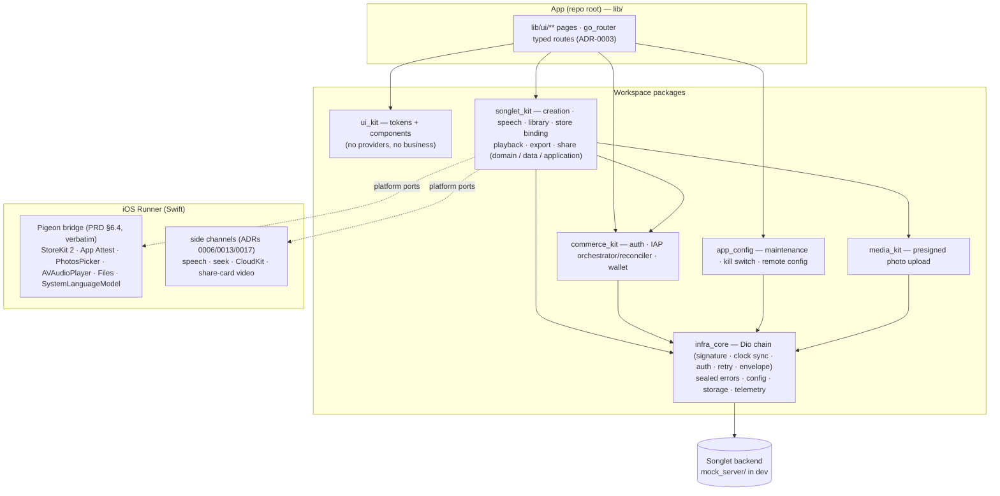

# Songlet (小曲)

An iOS app that writes a song for someone and a moment — birthday, wedding, love
story, festival, a team anthem or a brand jingle — in the listener's language, with
Google **Lyria 3** (through the Songlet backend). Pick one of 16 templates or describe
the song in your own words (typed, dictated on-device, or from 1–10 photos); a free
**30-second preview** plays in well under 90 s; the **≈2-minute full song** sits
behind a StoreKit 2 paywall and downloads as MP3 (WAV on Premier once the backend enables it) + lyrics + a
commercial-license PDF, or shares as a 9:16 video card that always carries the
"AI generated" label. 13 UI languages, every genre in every region, no accounts,
no third-party analytics, ads or crash SDKs.

## Quick start

```bash
flutter pub get
cp config/mock.example.json config/mock.json
make mock                        # terminal 1 — mock backend on :8787
make run ENV=mock                # terminal 2 — the app on a booted iOS simulator
```

| Gate / tool | Command |
| --- | --- |
| Everything CI runs | `make gates` (analyze → arch_guard → app + package + mock tests → iOS config-only build → xcconfig verify → shellcheck) |
| Simulator acceptance (XCUITest, PRD §13.2 + §12.4) | `make acceptance SIM=<udid>` (mock running) |
| First-session integration test | `make integration SIM=<udid>` (mock running) |
| Prototype fidelity report | `make diff-report` → `docs/ui/diff-report.md` |
| Regenerate the Pigeon bridge | `make pigeon` |

## Architecture



### Layering rules (machine-checked by `arch_guard`, `make arch`)

- Dependencies point one way: `lib/ui → packages`; `ui_kit` never sees business code and
  business packages never import `ui_kit`.
- Inside each package: `application → domain ← data`. `domain/` is pure Dart (no Flutter
  UI, Dio, Riverpod, `data/` or `application/` imports); concrete `data/` classes are bound
  only in the package's `*_providers.dart`.
- UI code adds **no providers**: pages read the packages' application layer.
- Layout is direction-safe: `EdgeInsetsDirectional` / `PositionedDirectional` only (no
  `left:`/`right:`, no `fromLTRB`).
- Sizes, colours, radii, motion and type come from `ui_kit` tokens (`SongletColors`,
  `SongletSpace`, `SongletSize`, `SongletRadius`, `SongletMotion`, `SongletType`) — no
  literals in pages or components.
- Native capabilities outside the fixed PRD §6.4 interface live on named side channels,
  each with an ADR.

Decisions are recorded in [`docs/adr/`](docs/adr/README.md); the backend contract the
client and mock implement is [`docs/songlet/backend-contract.md`](docs/songlet/backend-contract.md).

## How to add…

### A page
1. Route: add an `AppRoute` subclass with `location` and a `parse` case in
   `lib/ui/routing/routes.dart`; add its `GoRoute` in `app_router.dart` (wrap pages built
   from path parameters in `_keyed`, ADR-0003).
2. Page: `lib/ui/<area>/<name>_page.dart`, built on `PageFrame` / `PushedHeader`; every
   actionable widget gets a `TestId('<area>.<name>', …)` (widget-test key + XCUITest id).
3. Copy: add the keys to **all 13** ARBs in `lib/l10n/arb/` (`test/l10n/arb_completeness_test.dart`
   fails otherwise), then `make l10n`.
4. Tests: widget tests for every state (default / loading / empty / error / disabled /
   success) under `test/pages/`; add a `PageCase` to `test/pages/page_goldens_test.dart` —
   the device-matrix sweep (every device, ×1 and AX5) and the diff-report capture pick
   it up automatically.
5. Docs: a row in `docs/ui/inventory.md`; `make diff-report` if there is a prototype.

### A component
1. `packages/ui_kit/lib/src/components/<name>.dart`: pure presentation — inputs and
   callbacks, localized strings passed in, tokens only, no providers.
2. Buttons: `Semantics(container: true, button: true, label: …)`; ≥ 44 pt targets.
3. Dynamic Type (ADR-0018): chrome caps with `SongletType.chromeMaxTextScale`; content
   reflows — check `SongletType.isAccessibilitySize(context)` for a stacked arrangement.
4. Export it from `packages/ui_kit/lib/ui_kit.dart` (sorted).
5. Tests: `packages/ui_kit/test/components/` with `goldenSheet` (light · dark · RTL).

### A UI language
1. `lib/l10n/arb/app_<locale>.arb` with every key of `app_en.arb` and the same
   placeholders; bump the count in `test/l10n/arb_completeness_test.dart`; `make l10n`.
2. iOS: `ios/Runner/<lang>.lproj/InfoPlist.strings` (usage descriptions) in the
   `InfoPlist.strings` variant group, and the language in the project's `knownRegions`.
3. If it is also a lyric language: add it to `LyricLanguage`
   (`packages/songlet_kit/lib/src/creation/domain/region_preset.dart`), to the backend
   contract's `lyric_language` list, and a lyric template to `mock_server/lib/src/lyrics.dart`.
4. RTL needs nothing extra (directional layout + RTL goldens).

### A genre
1. Add the value to `Genre` (`packages/songlet_kit/lib/src/creation/domain/genre.dart`) —
   its label is Lyria prompt vocabulary and stays English in every UI language; the
   genre panel lists `Genre.values`, in every region (ADR-0005).
2. Add it to the genre list in `docs/songlet/backend-contract.md` §3 (the server accepts
   the label in the prompt block).
3. Update the golden of the genre panel (P02c) and the domain test's count.

### A country preset
1. Add a `RegionPreset` to `RegionPresets.all` (`region_preset.dart`): alpha-2 `code`,
   storefront `alpha3`, flag, lyric languages (first = default), exactly three genres,
   instruments, launch wave. Its pricing tier follows `SongletCatalog.tierForStorefront`.
2. Name: a `country<CODE>` key in all 13 ARBs and a case in `countryName`
   (`lib/ui/create/create_labels.dart`).
3. Server side: the backend contract's `region` list (§3) and the mock's
   `Catalog.presetRegions`; festivals of that region go in `Festival` (`occasion.dart`).
4. Tests: the region-preset domain tests and the region sheet golden (P02).

## Documentation map

| Topic | Where |
| --- | --- |
| Product spec · prototypes · screen inventory | `docs/design/` · `docs/ui/P*.png` · [`docs/ui/inventory.md`](docs/ui/inventory.md) |
| Prototype fidelity report | [`docs/ui/diff-report.md`](docs/ui/diff-report.md) |
| Architecture decisions | [`docs/adr/`](docs/adr/README.md) |
| Backend contract (hand-off to the platform repo, §7) | [`docs/songlet/backend-contract.md`](docs/songlet/backend-contract.md) |
| Acceptance run + StoreKit checklist | [`docs/songlet/acceptance.md`](docs/songlet/acceptance.md) |
| Performance method + results | [`docs/perf/performance.md`](docs/perf/performance.md) |
| Delivery self-audit | [`docs/audit/`](docs/audit/) |
| Template infrastructure invariants | [`CLAUDE.md`](CLAUDE.md) |

Songlet is built on the **iap_template** below: its packages are reused as they
are, and `packages/songlet_kit` binds Songlet's StoreKit 2 bridge (Pigeon, PRD §6.4),
App Attest identity and entitlement ledger into them through provider overrides.

---

## Template: iap_template

A reusable, **enterprise-grade IAP + AIGC infrastructure template** for Flutter,
shipped as a **pub-workspace monorepo with the app at the repo root**.

## Structure

**One repo = one app.** The app is at the repo root; the reusable libraries are
workspace members under `packages/`.

```
./             the app: lib/ (ui + providers + l10n), ios/ macos/ …, config/, test/   → all packages
packages/
  infra_core/    network · crypto (HMAC) · sealed errors · config · storage · device   (no business/UI)
  commerce_kit/  auth + iap + wallet  (domain / data / application)                     → infra_core
  app_config/    runtime governance: maintenance / kill-switch / remote config         → infra_core
  ui_kit/        Aura visual primitives + design tokens                                 (no business/providers)
  arch_guard/    dev-only architecture-boundary checker (Gate 6)                        (not shipped)
  media_kit/     presigned direct upload (sign → PUT → finalize)                        → infra_core
  songlet_kit/   Songlet business core (creation · library · store binding · playback · export · share)
mock_server/     dev-only mock of the Songlet backend (Dart)
pigeons/         the PRD §6.4 Pigeon bridge definition
```

Dependency direction (one-way): `ui → app/providers → commerce_kit(application →
domain ← data) → infra_core`; `ui → ui_kit`; `* → infra_core`. See `CLAUDE.md` for
the full architecture and invariants, and `docs/api/*` for the backend contracts.

## Getting started

Requires Flutter ≥ 3.44 (SwiftPM on by default), iOS ≥ 15. Verified on Flutter
3.44.2 / Dart 3.12.2 / Xcode 26.5.

All commands run from the repo root (the app lives there).

```bash
# Configure secrets (never committed):
cp config/dev.example.json config/dev.json
#   edit dev.json → BASE_URL, DISTRIBUTION_CODE, DISTRIBUTION_SECRET, APP_CODE, BUNDLE_ID, IAP_CHANNEL
#   BASE_URL is the Songlet BFF on the products domain (https://genaistudio-products.showsapp.org/v1,
#   or http://localhost:9910/v1 for a local product-api) — never the platform domain, which has
#   no /v1/attest, /v1/templates … and answers every call with 404; `make` rejects it
#   (store builds additionally require the legal-link fallbacks TERMS_URL + PRIVACY_URL)

make get          # flutter pub get (resolves the whole workspace)
make run          # flutter run on a picked device, with config/dev.json injected
```

`make` is the config-aware entrypoint — it injects `config/<env>.json` for you (and
fails fast if it's missing). The raw form still works:
`flutter run --dart-define-from-file=config/dev.json`.

`EnvConfig` reads every value via `String.fromEnvironment` only — **zero hardcoded
secrets in source** (the value is still compiled into the built binary, so the HMAC
`DISTRIBUTION_SECRET` is extractable from a shipped app — make it per-distribution +
rotatable; the real defences are server-side). `config/*.json` is git-ignored.

## Store builds

```bash
cp config/dev.example.json config/prod.json   # fill prod values, ENV=prod
make ipa          # App Store archive  (config/prod.json)
make aab          # Play Store bundle  (config/prod.json)
```

Per-product release setup (identity, signing, store config) → `docs/RELEASE_CHECKLIST.md`.
Signing/upload (certs, provisioning profiles, export options, Play signing) is Xcode /
Play Console setup — `make` only injects config and runs `flutter build`.

**Archiving via the Xcode UI** (Product → Archive) does **not** read `config/prod.json` —
Xcode reads the dart-defines from `ios/Flutter/Generated.xcconfig`, which holds whatever the
**last `flutter` command** generated (e.g. dev after `make run`). Run **`make xcconfig`**
(regenerates it as prod) right before archiving, and don't `make run` in between. `make ipa`
avoids the whole issue (it injects + archives in one step).

Forgetting is caught, not just warned about: the Runner target's first build phase
(*Verify Build Config* → `scripts/verify_xcode_config.sh`) fails any Xcode build whose
dart-defines are missing, stale, or non-prod in a `Release` configuration. `make verify-xcode-config`
runs the same check by hand. If a misconfigured build ever gets past both, the app stops at
startup with "App configuration problem" (and no misleading retry button) instead of reporting a
connection error.

## Gates

```bash
make gates                                    # everything below, as CI runs it
flutter analyze                               # app + all packages (root analyze descends into members)
flutter test                                  # app tests
dart run melos exec --ignore=songlet_mock_server -- flutter test   # each Flutter package's tests
(cd mock_server && dart test)                 # the mock backend (pure Dart: real sockets, so `dart test`)
dart run arch_guard                           # architecture boundaries
flutter build ios --config-only --no-codesign # SwiftPM resolves all plugins
```

## Reusing in a new project

Copy the repo, then switch the member `path:` dependencies (in each `pubspec.yaml`)
to `git: { url: <repo>, ref: <tag> }`, and the app's member `path:` deps likewise.
Set your distribution config in `config/<env>.json` and run.

## Localization (i18n)

Songlet ships **13 languages** (see "How to add a UI language" above). The
template itself ships only the **en + zh baseline** (`lib/l10n/arb/app_en.arb` +
`app_zh.arb`, with `app_en.arb` as the template ARB) → `flutter gen-l10n` →
`lib/l10n/generated/`. This is deliberate: keep the maintained source minimal, and
when you copy the template for a real app, **batch-translate the languages you
actually ship from the en/zh baseline** and drop each `app_<locale>.arb` next to
these two (then `make l10n`). RTL is already handled structurally — `*Directional`
layout, the `no_hardcoded_directional` lint, direction-aware gradients, and an RTL
golden — so adding an RTL language (e.g. `ar`) needs only its ARB. Backend error copy
is localized server-side via the `X-Language` header; the app supplies only store/UI
strings.

## Tests

1,265 unit, widget and golden tests (app 500 · packages 692 · mock backend 73), plus
the 8-case XCUITest acceptance suite and the integration test: the
template's chain end to end (HMAC signing verified byte-exact against `openssl`,
clock-skew-corrected signing, the interceptor chain, the auth state machine, the IAP
orchestrator/reconciler, wallet gating, storage migration, governance, the
architecture checker) plus Songlet's domain, controllers and repositories, every
page in every state, 22 page goldens, component goldens in light/dark/RTL, the
device-matrix sweep (6 devices × default and largest Dynamic Type), leak checks of
the main flows, the mock's contract tests, the simulator acceptance suite and the
first-session integration test.
