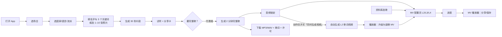
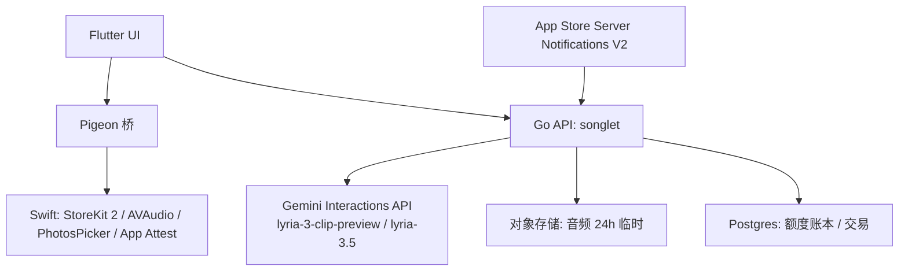
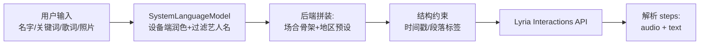

# AI 音乐创作 iOS 应用 PRD（Lyria 3）

Sep 24, 2026 · @lintion

## 1. 市场调研：全球 AI 音乐创作应用与 App Store 地区数据

结论先行：AI 音乐创作已是一个被 Suno 验证过的、年收入 3 亿美元级别的赛道；下载量集中在美国、印度、印尼、巴西，但 iOS 付费能力集中在美国、日本、英国、德国。以下全部为公开可查的估算或公司披露数据，估算值以来源为准。

### 1.1 赛道规模：Suno 是唯一有完整公开数据的头部产品

| 指标 | 数值 | 时点 | 来源 |
| --- | --- | --- | --- |
| ARR | 3 亿美元 | 2026-02 | [TechCrunch](https://techcrunch.com/2026/02/27/ai-music-generator-suno-hits-2-million-paid-subscribers-and-300m-in-annual-recurring-revenue/) |
| 付费订阅用户 | 200 万 | 2026-02 | [TechCrunch](https://techcrunch.com/2026/02/27/ai-music-generator-suno-hits-2-million-paid-subscribers-and-300m-in-annual-recurring-revenue/) |
| 累计用户 | 1 亿+，其中近 50% 首次用户触达免费上限 | 2026-02 | [Sacra](https://sacra.com/c/suno/) |
| 累计下载（iOS+Android） | 约 3,000 万 | 2025-Q3 | [Business of Apps](https://www.businessofapps.com/data/suno-statistics/) |
| 美国 iOS 单月下载 / 收入（估算） | 约 100 万 / 400 万美元 | 2026-01 | [Sensor Tower](https://app.sensortower.com/overview/6480136315?country=US) |
| 估值 | 54 亿美元（Series D 4 亿美元） | 2026-06 | [Sacra](https://sacra.com/c/suno/) |
| 定价 | 免费 10 首/日；Pro 10 美元/月；Premier 30 美元/月 | 2026 | [Sacra](https://sacra.com/c/suno/) |

Suno 季度下载（Appfigures / AppMagic 估算，百万）：2024-Q4 1.9 → 2025-Q1 8.6 → 2025-Q2 11.5 → 2025-Q3 7.5，说明 2025 年 Q2 是 iOS 端 AI 音乐的下载峰值，之后进入存量竞争（[来源](https://www.businessofapps.com/data/suno-statistics/)）。

### 1.2 地区分布：下载量与付费能力错位

Suno 累计下载国家分布（AppMagic，iOS+Android）：

| 国家 | 下载占比 |
| --- | --- |
| 美国 | 15% |
| 印度 | 13% |
| 印尼 | 10% |
| 巴西 | 8% |
| 俄罗斯 | 4% |
| 德国 | 4% |

来源：[Business of Apps](https://www.businessofapps.com/data/suno-statistics/)。

2025 年 App Store 各国下载量（AppTweak，2024-11 至 2025-11）：

| 国家 | iOS 下载 | App Store 份额 | 同比 |
| --- | --- | --- | --- |
| 美国 | 68 亿 | 22.5% | +2% |
| 中国大陆 | 42 亿 | 13.8% | -4% |
| 日本 | 14 亿 | 4.7% | +6% |
| 巴西 | 14 亿 | 4.5% | +18% |
| 英国 | 12 亿 | 4.1% | +9% |
| 印度 | 11 亿 | 3.7% | +22% |
| 俄罗斯 | 11 亿 | 3.6% | +13% |
| 德国 | 9 亿 | 2.9% | +9% |
| 越南 | 9 亿 | 2.8% | +18% |
| 法国 | 8 亿 | 2.8% | +11% |

来源：[AppTweak App downloads by country 2025](https://www.apptweak.com/en/reports/app-downloads-by-country)。同一报告指出：全球下载量同比 -4.1%，但收入同比 +10.5%（1,333 亿 → 1,472 亿美元），增长来自付费深度而非安装量。

付费侧：Sensor Tower State of Mobile 2026 给出 2025 年全球 IAP 收入 1,670 亿美元（+10.6%），美国 590 亿美元居首，中国（仅 iOS）221 亿美元第二；印度以 255 亿次下载居下载首位（[Sensor Tower](https://sensortower.com/blog/state-of-mobile-2026)，[报告摘要](https://gamedevreports.substack.com/p/sensor-tower-the-state-of-the-mobile)）。生成式 AI 应用 2025 年全球下载 38 亿次，同比翻倍（[Sensor Tower 摘要](https://quashbugs.com/blog/mobile-app-download-statistics)）。

### 1.3 用户态度：能接受创作，要求标注

Deezer 与 Ipsos 在美、加、巴西、英、法、荷、德、日 8 国对 9,000 人的调查（2025-10）：97% 无法在盲听中分辨 AI 与人工作品；80% 要求 100% AI 生成的音乐被明确标注；73% 的流媒体用户希望知道平台是否在推荐 AI 曲目（[Deezer Newsroom](https://newsroom-deezer.com/2025/11/deezer-ipsos-survey-ai-music/)）。Deezer 平台每日新上传曲目中 AI 生成占比已从 2025-11 的 34% 升至 2026-07 的 50% 以上（[Deezer](https://newsroom-deezer.com/2026/07/ai-music-exceeds-50-percent-daily-uploads-deezer/)）。

### 1.4 订阅经济：AI 应用卖得贵、掉得快

RevenueCat State of Subscription Apps 2026（11.5 万款应用、160 亿美元收入）：AI 应用每付费用户首年 LTV 中位数 30.16 美元，比非 AI 应用高 41%，但月付计划 12 个月留存差 36%；硬付费墙 35 日下载到付费转化 10.7%，免费增值仅 2.1%；17 天以上试用转化 42.5%，4 天以内仅 25.5%；大多数试用取消发生在第 0 天（[RevenueCat](https://www.revenuecat.com/state-of-subscription-apps)，[摘要](https://www.revenuecat.com/blog/growth/subscription-app-trends-benchmarks-2026)）。

### 1.5 竞争与版权格局

Suno 与 Warner 于 2025-11 达成授权和解，条件包括新授权模型上线后旧模型下线、下载需付费账户、付费档设月下载上限（[Sacra](https://sacra.com/c/suno/)）；Udio 与 UMG、Warner 和解后转为流式「围墙花园」，导出受限（[OpusClip 汇总](https://www.opus.pro/blog/ai-music-news-april-2026)）；Sony 诉讼仍在进行（[NPR](https://www.npr.org/sections/planet-money/2026/08/18/g-s1-138852/grueling-fight-over-who-profits-from-ai-music)）。这意味着：头部产品的「随意生成、随意下载」正在收紧，合规来源与可下载性会成为差异点。

## 2. 数据结论与产品定位

产品定名 **Songlet**（中文名「小曲」），定位为「为某个人、某个时刻、用你的语言写一首歌」的场合型 AI 音乐创作 App，不做 Suno 式的通用创作工作台。

### 2.1 从第 1 章数据推出的六条结论

| 数据事实 | 推导结论 | 落到产品的决定 |
| --- | --- | --- |
| Suno 3 亿美元 ARR、1 亿用户，通用创作工作台已被占住 | 正面对抗通用工作台无胜算 | 切「场合 + 地域语言」细分：生日、婚礼、纪念日、告白、品牌短曲、旅行 vlog 配乐 |
| 下载集中在美/印/印尼/巴西，iOS 付费集中在美/日/英/德/法 | 下载国与付费国错位 | 首发 7 个高 ARPU 国家；印度、巴西、印尼、墨西哥用本地化低价拉量 |
| iOS 各国下载量 2025 年仍在增长（巴西 +18%、印度 +22%、越南 +18%） | 新兴市场 iPhone 渗透在涨 | 这些国家不放弃，但用按国家定价，不用统一美元价 |
| 97% 分不清 AI 与真人；80% 要求标注 | 音质已不是壁垒，可信与标注是 | 每首歌带 SynthID 水印与「AI 生成」标注，产品页主动声明，作为卖点而非负担 |
| AI 应用 LTV 高 41% 但 12 个月留存差 36%；硬付费墙转化 10.7% vs 免费 2.1%；试用取消集中在第 0 天 | 首个会话必须产出可分享成品 | 首次打开 90 秒内生成并可分享一首 30 秒片段；硬付费墙放在「完整歌曲」上 |
| Suno、Udio 与唱片公司和解后，下载与导出收紧 | 「可下载、可商用、来源合规」成稀缺 | 付费用户全部歌曲可下载 MP3/WAV 并附商用许可，Lyria 3 的授权与水印是护城河 |

### 2.2 差异化：Lyria 3 能做而竞品不主打的三件事

1. 按提示词语言出歌词：Lyria 3.5 自动用提示词所用语言生成歌词并适配发音（[Google 文档](https://ai.google.dev/gemini-api/docs/music-generation)），Songlet 把它做成「选国家 = 选语言 + 选流派」的一步操作。
2. 图片生歌：最多 10 张图片作为输入（[Google 文档](https://ai.google.dev/gemini-api/docs/music-generation)），Songlet 主打「相册选几张照片，出一首属于这段记忆的歌」。
3. 结构化时间轴：`[0:00 - 0:10] Intro` 式的时间标记控制，Songlet 用它保证短视频配乐在第 3 秒有 hook、第 15 秒进副歌。

### 2.3 明确不做

- 不做社区、信息流、评论、榜单（UGC 会触发 1.2 审核并增加审核成本）。
- 不做歌手模仿、声音克隆、真人艺人风格（Lyria 安全过滤会拦截，且与版权风险直接相关）。
- 不做分轨、混音、多轮编辑（Lyria 3.5 为单轮生成，不支持迭代编辑）。
- 不做 Android、不做 Web，V1 只做 iOS。
- 不做中国大陆、香港、澳门、俄罗斯等 Gemini API 不可用地区（见第 11 章）。

## 3. 目标用户与核心场景

核心用户是「有一个具体的人或时刻要表达、但不会做音乐」的普通人，而不是创作者。

| 画像 | 触发场景 | 产出物 | 首发国家 |
| --- | --- | --- | --- |
| 送礼者（25–45 岁） | 生日、周年、求婚、母亲节 | 2 分钟带歌词完整歌 + 歌词卡片 | 美、英、加、澳、德、法、日 |
| 短视频作者 | Reels / TikTok / Shorts 配乐要「前 3 秒有 hook」 | 30 秒片段，竖版分享卡 | 全部地区 |
| 小商家 | 店铺开业、品牌 jingle、播客片头 | 30 秒无人声或带口号的片段，附商用许可 | 美、英、德、日、巴西 |
| 节日与文化场景用户 | 排灯节、狂欢节、春节（海外华人）、开斋节 | 本地语言 + 本地流派完整歌 | 印度、巴西、印尼、马来西亚、新加坡 |

### 3.1 核心流程（首个会话）



从打开到第一次试听，目标 90 秒内完成，其中 Lyria 生成等待不超过 45 秒。

## 4. V1.0 功能范围与优先级

V1.0 只交付「场合 → 片段 → 完整歌 → 下载分享」一条闭环，共 14 项功能，P0 全部为上线门槛。

| 编号 | 功能 | 优先级 | 验收要点 |
| --- | --- | --- | --- |
| F01 | 场合模板：生日、周年、告白、婚礼、纪念、节日、品牌、配乐（8 个） | P0 | 每个模板有固定提示词骨架（第 7 章） |
| F02 | 地区预设：国家 → 语言 + 3 个本地流派 | P0 | 第 7.3 节映射表，首发 14 国 |
| F03 | 文本输入：收件人名字、3 个关键词、可选自写歌词 | P0 | 歌词 ≤ 1,200 字符，自动加 `[Verse]/[Chorus]` 标签 |
| F04 | 图片生歌：PhotosPicker 选 1–10 张 | P0 | 图片压缩至长边 1024px、JPEG 质量 0.8 后上传，本地不保留副本 |
| F05 | 30 秒片段生成（lyria-3-clip-preview） | P0 | 免费额度内可用，返回 MP3 + 歌词 |
| F06 | 完整歌曲生成（lyria-3.5） | P0 | 仅付费，返回 MP3；WAV 为 Premier 档 |
| F07 | 播放器：波形、歌词同步滚动、循环 | P0 | 后台播放，锁屏控制 |
| F08 | 分享卡：竖版 9:16 视频（封面 + 歌词 + 音频） | P0 | 系统分享面板，含「AI 生成」角标 |
| F09 | 下载：MP3/WAV 到「文件」或「音乐」 | P0 | 付费用户；附 PDF 商用许可 |
| F10 | 作品库：本地存储，按场合分组 | P0 | 无账号；iCloud 同步默认关，可开 |
| F11 | StoreKit 2 订阅 + 歌曲包 | P0 | 第 8 章 |
| F12 | 生成状态与降级：排队、重试、失败退额 | P0 | 第 6.4 节错误映射 |
| F13 | 12 种界面语言本地化 | P0 | 第 11 章 |
| F14 | 歌词二次生成（同一提示换一版） | P1 | 计一次片段额度 |

### 4.1 创作参数（对齐 Gemini 应用的 Lyria 3 界面）

创作页采用「模板网格 + 单条输入框 + 三个参数选择器」结构，与 Gemini 应用一致，用户无学习成本；Songlet 在其上叠加场合与地区层。三个参数直接映射到模型与提示词：

| 参数 | 选项 | 映射 | 默认值 |
| --- | --- | --- | --- |
| 时长 | 短版 / 标准 | 短版 = `lyria-3-clip-preview`（30 秒，免费额度）；标准 = `lyria-3.5`（约 2 分钟，付费） | 短版 |
| 人声 | 开启人声 / 纯音乐 / 自定义（按提示） | 开启 = `{vocal_profile}` 取地区预设；纯音乐 = 提示词追加 "Instrumental, no vocals" 且不传歌词；自定义 = 用户一句话经 SystemLanguageModel 归一为 vocal\_profile | 开启人声 |
| 流派 | 自定义（按提示）+ 18 个固定流派：流行、嘻哈与说唱、摇滚、K-pop、拉丁、电子、R&B、乡村、非洲节拍、雷鬼、爵士与布鲁斯、古典、民谣、低保真、原声、电影配乐、氛围音乐、Bossa Nova | 固定流派用 Lyria prompt guide 词表；地区预设（7.3）只决定该国排在最前的 3 个流派，不减少可选项 | 地区预设流派 1 |

输入框配套控件：`+` 打开照片选择（F04）与「导入我的歌词」；麦克风 = 设备端 SFSpeechRecognizer 转写后经 SystemLanguageModel 整理为关键词或歌词（「语音生成歌曲」模板）；不显示模型名，只显示「预览 / 完整」。

「同时生成视频」开关：位于时长选择器旁；打开时完整歌生成完成并锁定音频后自动生成 L2 歌词视频（不经配置页，用模板默认比例与封面，不计视频额度）；在「视频配乐」「业务宣传」「节日」三个模板下默认打开，其余模板默认关闭；仅 Premier 用户可在此处选择「歌 + 副歌 MV 一次生成」，且 MV 启动前 10 秒内可取消不扣视频额度。

模板由 8 个扩展为 16 个，对齐 Gemini 模板集并保留场合定位：生日祝福、生日庆祝、爱情故事、感谢朋友、派对邀请函、婚礼、纪念、节日（地区化）、铃声、队歌、体育赛事回顾、说唱对决、喜剧、宠物颂歌、家乡特辑、业务宣传、天气报告、语音生成歌曲、视频配乐。每个模板绑定：默认时长、默认人声、推荐流派、提示词骨架（7.2）。

P1 与后续版本（V1.1）：Lyria RealTime 互动模式、Apple Watch 遥控、iMessage 贴纸分享、Siri 快捷指令。

## 5. Lyria 3 能力、限制与技术约束

全部依据 Google 官方文档（[Generate music with Lyria 3.5](https://ai.google.dev/gemini-api/docs/music-generation)，2026-09-23 更新）。

| 项目 | lyria-3-clip-preview | lyria-3.5 |
| --- | --- | --- |
| 时长 | 固定 30 秒 | 约 2 分钟，可用提示词或时间戳影响 |
| 输出 | MP3，44.1 kHz 立体声 | MP3 默认；`response_format: {type: audio}` 可得 WAV |
| 输入 | 文本 | 文本 + 最多 10 张图片 |
| 歌词 | 随音频一并返回 | 随音频一并返回，含结构 JSON |
| 调用方式 | Interactions API `POST /v1beta/interactions` | 同左 |
| 付费单价（Google 定价页转载） | 0.04 美元/首 | 0.08 美元/首 |

单价来自 [BenchLM 对 Google 定价页的抓取](https://benchlm.ai/md/media-pricing/lyria.md)（2026-09-11）与 [invideo 汇总](https://invideo.io/blog/lyria-ai-music-generator/)；上线前以 [Google 定价页](https://ai.google.dev/gemini-api/docs/pricing) 复核，无免费层。

### 5.1 必须在产品中吸收的限制

- 单轮生成，不支持多轮编辑：产品上「再来一版」= 重新生成并重新计费，UI 不承诺「微调」。
- 安全过滤会拦截指定艺人声音与受版权保护歌词的提示：客户端在提交前做艺人名黑名单与歌词相似度粗筛，减少无效计费。
- 所有音频带 SynthID 水印，不可去除：作为产品声明写入 App 内与商店描述。
- 结果不确定，同一提示词每次不同：作品库保存提示词与 `interaction.id`，便于用户重复生成同风格。
- 图片输入上限 10 张：UI 硬限。
- 输入上限 131,072 token：与本产品无关，歌词上限由产品自定为 1,200 字符。
- 地区：Gemini API 仅在 [官方列表](https://ai.google.dev/gemini-api/docs/available-regions) 所列国家/地区可用，列表不含中国大陆、香港、澳门、俄罗斯。
- API 密钥不可下发到客户端：所有调用经 Go 后端，密钥只存在服务端。

## 6. 系统架构

本产品是本组合内第一个必须带后端的 SKU：Lyria 是第三方云 API，密钥、配额与计费必须在服务端。客户端仍沿用 Flutter + Pigeon + Swift；后端沿用已有 Go 单体（DDD + Clean Architecture + CQRS），新增 `songlet` 限界上下文。

### 6.1 组件图



### 6.2 与组合内其他 SKU 的差异（有意为之）

| 组合默认 | Songlet 决定 | 原因 |
| --- | --- | --- |
| 零后端 | Go 后端代理 | 密钥与计费不能放客户端 |
| Foundation Models → PCC 路由 | 不用 Foundation Models 生成音乐 | Apple 无音乐生成模型；仅用 SystemLanguageModel 做提示词润色与歌词翻译（设备端，无成本） |
| 零第三方 SDK、零分析 | 保持 | 后端自采最小化事件（生成成功率、耗时），不接第三方分析 |
| 强制 FaceID 锁 | 改为可选 | 音乐非隐私敏感内容，强制锁伤害首个会话转化 |
| CloudKit 私有库同步默认关 | 保持 | 作品 MP3 与歌词走 CloudKit，可选开启 |
| iOS 27.0 最低版本 | 保持 | 使用 SystemLanguageModel 与 PhotosPicker 新 API |

### 6.3 后端接口契约（Go，JSON）

| 方法 | 路径 | 请求 | 响应 |
| --- | --- | --- | --- |
| POST | `/v1/generate` | `{model, occasion, region, prompt, lyrics?, images?[], client_ref}` | `{job_id, eta_seconds, credits_charged}` |
| GET | `/v1/jobs/{job_id}` | — | `{status, audio_url?, lyrics?, structure?, error_code?}` |
| POST | `/v1/entitlements/sync` | `{app_account_token, signed_transactions[]}` | `{tier, songs_left, clips_left, reset_at}` |
| POST | `/v1/attest` | App Attest 断言 | `{device_token}` |
| GET | `/v1/license/{job_id}` | — | PDF 商用许可 |

鉴权：无账号；`app_account_token`（StoreKit 2 UUID）+ App Attest 设备令牌。音频在对象存储保留 24 小时后删除，客户端在生成完成时立即下载到本地。

### 6.4 Pigeon 桥接口（Swift 侧）

```
@HostApi
abstract class SongletNativeApi {
  @async List<SKProductDto> fetchProducts(List<String> ids);
  @async PurchaseResultDto purchase(String productId, String appAccountToken);
  @async List<String> currentSignedTransactions();
  @async String appAttestAssertion(String challenge);
  @async List<Uint8List> pickPhotos(int max);           // 已压缩 JPEG
  @async void playAudio(String path, bool loop);
  @async void exportToFiles(String path, String name);
  @async String polishPrompt(String raw, String locale); // SystemLanguageModel
}

@FlutterApi
abstract class SongletFlutterApi {
  void onPlaybackProgress(double seconds);
  void onTransactionUpdated(String signedTransaction);
}
```

### 6.5 错误映射表

| 后端 error\_code | 触发 | 用户文案（英文原文） | 处理 |
| --- | --- | --- | --- |
| `SAFETY_BLOCKED` | Lyria 安全过滤 | We can't make this one — try different words, and skip artist names. | 不扣额度 |
| `QUOTA_EXHAUSTED` | 本月额度用完 | You've used this month's songs. Add a pack or upgrade. | 弹付费页 |
| `UPSTREAM_TIMEOUT` | Lyria > 120 秒无响应 | Taking longer than usual. We'll keep trying and notify you. | 后端重试 2 次后退额 |
| `UPSTREAM_RATE_LIMITED` | 429 | Lots of songs being made right now. Yours is queued. | 队列，最长等待 5 分钟 |
| `REGION_UNAVAILABLE` | 设备地区不在支持列表 | Songlet isn't available in your region yet. | 阻断生成，允许播放已有作品 |
| `ATTEST_FAILED` | App Attest 失败 | Please update Songlet from the App Store. | 阻断生成 |
| `IMAGE_REJECTED` | 图片内容被拒 | One of these photos can't be used. Try another. | 不扣额度 |
| `NETWORK_OFFLINE` | 客户端离线 | You're offline. Your library still works. | 仅作品库可用 |

## 7. 生成流程、Prompt 规范与地区风格映射

提示词由后端按「场合骨架 + 地区预设 + 用户输入 + 结构约束」四段拼装，客户端不直接拼接原始提示词。流派与乐器词汇取自 [Lyria prompt guide](https://ai.google.dev/gemini-api/docs/lyria-prompt-guide)（2026-09-17 更新）。

### 7.1 拼装流程



### 7.2 逐字提示词模板

片段（lyria-3-clip-preview，30 秒，配乐场景）：

```
{genre_primary} with {genre_secondary} influences, {mood}, around {bpm} BPM, in {key}.
{instruments}. {vocal_profile}.
[0:00 - 0:03] Intro: a strong hook immediately, no silence.
[0:03 - 0:15] Verse: {theme_line}.
[0:15 - 0:30] Chorus: the lyrics repeat the name "{recipient}" and the phrase "{keyword_1}".
{lyric_language_instruction}
```

完整歌（lyria-3.5，约 2 分钟，生日场合示例）：

```
A heartfelt {genre_primary} birthday song for {recipient}, {mood}, around {bpm} BPM, in {key}.
{instruments}. {vocal_profile}. Duration about 2 minutes.
The lyrics are about {keyword_1}, {keyword_2} and {keyword_3}. Mention the name "{recipient}" in every chorus.
Structure: [Intro] -> [Verse 1] -> [Chorus] -> [Verse 2] -> [Chorus] -> [Bridge] -> [Chorus] -> [Outro].
{lyric_language_instruction}
```

自写歌词时，在上面模板末尾追加：

```
Use exactly these lyrics, do not add new lines:

Lyrics:

{user_lyrics_with_section_tags}
```

图片生歌时，文本部分改为：

```
Compose a {genre_primary} song inspired by the people, places, colors and mood in these photos. {mood}, around {bpm} BPM. {vocal_profile}. The lyrics describe what is happening in the photos without naming any real person other than "{recipient}".
{lyric_language_instruction}
```

`{lyric_language_instruction}` 固定为该地区语言写成的一句话，例如日语预设为「歌詞は日本語で、自然な発音で歌ってください。」，葡萄牙语（巴西）为「A letra deve ser em português brasileiro.」。Lyria 按提示词语言出歌词，因此整段提示词的最后一句必须是目标语言。

### 7.3 地区预设表（首发 14 国）

| 国家 | 歌词语言 | 流派 1 | 流派 2 | 流派 3 | 默认乐器 |
| --- | --- | --- | --- | --- | --- |
| 美国 | 英语 | Indie Pop | Contemporary R&B | Country (Alternative Country) | Warm Acoustic Guitar, Rhodes Piano |
| 英国 | 英语 | Indie Pop | Garage Rock | Grime | Guitar, Synth Pads |
| 加拿大 | 英语 / 法语 | Indie Folk | Synthpop | Piano Ballad | Warm Acoustic Guitar |
| 澳大利亚 | 英语 | Indie Pop | Surf Rock | Deep House | Guitar |
| 德国 | 德语 | Synthpop | Minimal Techno | Piano Ballad | Synth Pads, Moog Oscillations |
| 法国 | 法语 | 1960s French yé-yé pop | Chillout | Piano Ballad | Smooth Pianos |
| 日本 | 日语 | J-pop 风 Indie Pop | Piano Ballad | Chiptune | Koto 点缀, Smooth Pianos |
| 韩国 | 韩语 | Synthpop | Contemporary R&B | Piano Ballad | Synth Pads |
| 巴西 | 葡萄牙语 | Bossa Nova | Funk (Disco Funk) | Reggaeton | Warm Acoustic Guitar, Conga Drums |
| 墨西哥 | 西班牙语 | Cumbia | Reggaeton | Latin Jazz | Guitar, Trumpet, Maracas |
| 印度 | 印地语 / 英语 | Bhangra | Indian Classical | Indie Pop | Tabla, Sitar |
| 印尼 | 印尼语 | Indie Pop | Piano Ballad | Reggae | Warm Acoustic Guitar |
| 越南 | 越南语 | Piano Ballad | Indie Pop | Lo-Fi Hip Hop | Smooth Pianos |
| 土耳其 | 土耳其语 | Indie Pop | Piano Ballad | Deep House | Guitar, Bouzouki |

### 7.4 客户端预检规则

- 艺人名黑名单：命中即提示改写，不提交（黑名单维护在后端配置，客户端每日拉取）。
- 「sound like」「in the style of」「voice of」+ 人名的模式：拦截。
- 用户歌词与内置公开歌词指纹库相似度 > 0.8：拦截并提示原创。
- 名字与关键词长度：名字 ≤ 24 字符，关键词 ≤ 20 字符 × 3。

## 8. 商业化：StoreKit 2 订阅与歌曲包

定价原则：片段免费引流、完整歌硬付费墙、年付定价低于月付 ×6、额度上限保证 100% 用满时仍不亏本（Google 单价 0.04 / 0.08 美元，Apple 小型企业计划抽成 15%）。

### 8.1 产品定义

| 产品 ID | 类型 | 美国价 | 内容 | 满额成本 | 净收入（-15%） |
| --- | --- | --- | --- | --- | --- |
| `com.songlet.pro.monthly` | 自动续订 | 9.99 美元/月 | 40 首完整歌 + 100 个片段/月，MP3，商用许可 | 7.20 美元 | 8.49 美元 |
| `com.songlet.pro.yearly` | 自动续订 | 59.99 美元/年 | 同上，按月重置 | 86.40 美元/年 | 50.99 美元 |
| `com.songlet.premier.monthly` | 自动续订 | 24.99 美元/月 | 120 首完整歌 + 200 个片段/月，MP3 + WAV | 17.60 美元 | 21.24 美元 |
| `com.songlet.pack.10` | 消耗型 | 4.99 美元 | 10 首完整歌，永不过期 | 0.80 美元 | 4.24 美元 |
| `com.songlet.pack.50` | 消耗型 | 19.99 美元 | 50 首完整歌，永不过期 | 4.00 美元 | 16.99 美元 |

年付满额成本高于净收入是有意接受的：按 RevenueCat 数据，年付计划在低价位留存更好，且实际额度利用率远低于 100%；后端对年付用户按月重置额度，不允许跨月累积。

### 8.2 免费额度与付费墙

- 免费：终身 3 个片段（成本 0.12 美元/设备），足够走完首个会话并分享。
- 完整歌曲：硬付费墙，无免费首数。
- 试用：Pro 年付提供 7 天免费试用，试用期内上限 10 首完整歌（防刷）；月付无试用。
- 首个会话付费页出现在第一次片段试听完成之后，而不是打开 App 时。

### 8.3 地区定价（Apple 按国家自定价）

| 层级 | 国家 | Pro 月付 | Pro 年付 |
| --- | --- | --- | --- |
| T1 | 美、英、加、澳、德、法、日、韩 | 本地等值 9.99 美元 | 本地等值 59.99 美元 |
| T2 | 巴西、墨西哥、印尼、越南、土耳其 | 本地等值 4.99 美元 | 本地等值 29.99 美元 |
| T3 | 印度 | ₹399 | ₹1,999 |

歌曲包各地区同比例折算。T2/T3 净收入仍高于满额成本（Pro 月付 T2 净 4.24 美元 vs 满额 7.20 美元的风险由 40 首上限在 T2/T3 降为 25 首完整歌 + 60 片段来消除，满额成本 4.40 美元）。

### 8.4 额度账本规则

- 扣费时点：生成任务创建即预扣；失败（除用户取消）自动退回。
- 订阅额度每个计费周期重置；消耗型歌曲包永不过期，优先消耗订阅额度，再消耗包。
- 恢复购买：通过 `Transaction.currentEntitlements` 与 App Store Server Notifications V2 双向核对。
- 退款：收到 `REFUND` 通知后冻结对应额度，已生成作品保留可播放但不可再下载。

### 8.5 已知审核雷区对应

- 3.1.1 消耗型额度不得过期：歌曲包永不过期；订阅额度是「使用权」而非「已购买的积分」，付费页文案写「每月 40 首」而非「每月赠送 40 积分」。
- 3.1.2 订阅信息：付费页必须显示价格、周期、自动续订说明与「管理订阅」入口。

## 9. 版权、内容安全与合规

合规立场靠架构事实陈述：所有音乐由 Google Lyria 3 生成，带 SynthID 水印，不模仿任何真实艺人。

### 9.1 版权与授权

- 生成内容归用户所有，依据 [Gemini API 服务条款](https://ai.google.dev/gemini-api/terms)；付费用户附 Songlet 商用许可 PDF，注明生成时间、`interaction.id`、许可范围（可用于个人、社媒、广告、播客，不可注册为独家版权作品）。
- 付费层使用 Gemini API 付费档，Google 不使用付费档内容改进产品（[定价页](https://ai.google.dev/gemini-api/docs/pricing)）；免费额度也走同一付费密钥，因此所有用户内容均不被 Google 用于训练。
- 用户自写歌词：用户勾选「歌词为我原创或我有权使用」；客户端做公开歌词指纹粗筛。
- 艺人名、乐队名、作品名：预检拦截；Lyria 安全过滤为第二道。

### 9.2 内容安全

- 图片输入：仅允许 PhotosPicker 选取；不允许网络图片；后端调用 Gemini 图片安全审查，命中即 `IMAGE_REJECTED`。
- 未成年人：App 年龄分级 4+，但完整歌曲需付费；不提供任何社交功能。
- 关键词与歌词：走 Lyria 内置安全过滤；不额外做本地情绪审查，避免误伤。

### 9.3 隐私

- 无账号、无第三方 SDK、无广告。
- 后端仅存：`app_account_token`、交易 ID、额度账本、任务元数据（无提示词原文，提示词原文仅在生成完成后 24 小时内保留供重试）。
- 音频与图片：对象存储 24 小时后自动删除；图片不落盘，仅在请求生命周期内存在。
- 隐私标签：「未与您关联的数据：用户内容（提示词、照片）用于应用功能」；不声明「未收集数据」，因为后端确实处理内容。
- 地区：欧盟用户数据处理依据合同履行；不做跨境以外的第三方共享。

### 9.4 AI 标注

- 每首歌的分享卡、元数据（ID3 `TXXX:AI_GENERATED=Lyria 3`）与作品详情页均标注「AI 生成」。
- App 内「关于生成」页说明 SynthID 水印存在且不可移除，呼应 Deezer/Ipsos 调查中 80% 用户的标注诉求。

## 10. App Store 审核说明与 ASO

### 10.1 审核备注（逐字，英文）

```
Songlet generates original songs from the user's text or photos using Google's Lyria 3 music model via the Gemini API (third-party AI, disclosed in-app under Settings > About generation and in the App Store description).

- No user accounts. Purchases are tied to the StoreKit appAccountToken.
- No user-generated content is shared between users; there is no feed, comments, or profiles.
- All generated audio carries Google's SynthID watermark and is labeled "AI generated" in the app and in shared files.
- Artist names and copyrighted lyrics are blocked before submission and again by the model's safety filters.
- Consumable song packs never expire. Subscription allowances reset each billing period.
- Photos are selected via PhotosPicker, sent over TLS for generation, and deleted from our servers within 24 hours.

Test instructions: open the app, tap "Birthday", choose "United States", enter the name "Alex" and keywords "coffee, hiking, Sunday", tap Create. A 30-second preview plays within about 45 seconds. Use the sandbox account provided to unlock a full song.
```

### 10.2 审核指南对照

| 指南 | 风险 | 对应措施 |
| --- | --- | --- |
| 5.1.2(i) 第三方 AI 披露 | 高 | 设置页与商店描述明示 Google Lyria 3 |
| 1.2 UGC | 低 | 无任何用户间内容传播 |
| 4.3 重复应用 | 中 | 场合模板 + 地区预设 + 图片生歌为核心差异，截图突出 |
| 3.1.1 消耗型过期 | 中 | 歌曲包永不过期，文案不写「积分」 |
| 5.2.3 音频内容 | 中 | 无版权音乐、无艺人模仿，审核备注说明 |
| 4.1 山寨 | 低 | 不使用 Suno / Udio 视觉与命名 |

### 10.3 ASO 字段（美国区，英文）

命名规则：搜索权重名称 > 副标题 > 关键词字段，三者不重复；名称 30 字符，不含竞品名、"free" 与无关词（指南 2.3.7）；每个 storefront 单独设本地化名称（Suno 美国区 "Suno - AI Songs & Music"、日本区 "Suno スーノ: AI音楽作成・作曲アプリ" 即此做法）。品牌 Songlet 固定，名称剩余字符全部给该地区最高意图关键词。

| Storefront | 应用名称（≤30） | 副标题（≤30） | 名称承载的搜索意图 |
| --- | --- | --- | --- |
| 美/英/加/澳 | Songlet: AI Song Maker & Gift | Birthday Songs, Photo to Music | ai song、song maker、gift |
| 日本 | Songlet: AI作曲・歌づくりアプリ | 誕生日ソング・写真から音楽 | AI作曲、歌、アプリ |
| 德国 | Songlet: KI Musik & Song Maker | Geburtstagslied, Foto zu Musik | KI Musik、Song Maker |
| 法国 | Songlet : Musique IA, Chanson | Chanson d'anniversaire, photo | musique IA、chanson |
| 巴西 | Songlet: Música com IA, Canção | Música de aniversário, foto | música IA、canção |
| 墨西哥 / 西语 | Songlet: Música IA y Canciones | Canción de cumpleaños, fotos | música IA、canciones |
| 印度（en-IN） | Songlet: AI Song & Music Maker | Birthday Song, Hindi & English | ai song、music maker |
| 韩国 | Songlet: AI 작곡 노래 만들기 | 생일 노래, 사진으로 음악 | AI 작곡、노래 만들기 |
| 印尼 | Songlet: Buat Lagu AI & Musik | Lagu ulang tahun dari foto | buat lagu、musik AI |
| 越南 | Songlet: Tạo Nhạc AI, Bài Hát | Nhạc sinh nhật từ ảnh | tạo nhạc AI |
| 土耳其 | Songlet: Yapay Zeka Şarkı Yap | Doğum günü şarkısı, fotoğraf | yapay zeka şarkı |
| 简体中文（新马、海外华人） | Songlet 小曲：AI写歌 生日歌 | 照片生成音乐，多语言歌词 | AI写歌、生日歌 |

关键词字段（100 字符，各 storefront 按本地语言翻译）：`lyrics,jingle,wedding song,anniversary,tiktok music,custom song,love song,song generator,music maker`。推广文本（170）：Turn a name, three words or a few photos into a real song with lyrics — in your language. Made with Google Lyria 3.

硬规则：AI / Song(Music) / Maker 三类词在名称中各出现一次，副标题不再重复；任何字段不写 Suno、Udio；名称语言与该 storefront 截图文案同语言。提交前在 Apple Search Ads 后台逐 storefront 查上述词的 popularity，低于 20 的词换用副标题中的备选词。

标识符：Bundle ID `com.songlet.ios`，Xcode / Flutter 项目名 `songlet`，Go 服务名 `songlet`，App Group `group.com.songlet.ios`，IAP 前缀 `com.songlet.`；域名与商标以 songlet.com / songlet.app 为准，被占则改用 Songlit（`com.songlit.ios`），其余不变。

### 10.4 截图脚本（6 张，竖版）

1. 「Say it with a song」：输入名字与三个关键词，生成按钮高亮。
2. 「From your photos」：相册选 4 张照片，右侧出现歌词卡。
3. 「In your language」：同一首歌的日语、葡萄牙语、印地语歌词并排。
4. 「Ready in 45 seconds」：播放器界面，波形 + 歌词滚动。
5. 「Share anywhere」：9:16 分享卡带「AI generated」角标。
6. 「Yours to keep」：下载 MP3/WAV + 商用许可 PDF。

每张截图文案按第 11 章 12 种语言本地化，图 3 在各国版本中把本国语言放在中间。

### 10.5 图标与 PPO 测试

App Store 图标全局唯一，不能按 storefront 本地化；主图标按收入权重向 T1（美、日、英、德、法）倾斜，T2/T3 偏好用 PPO 按国家测试，胜出结果落到可本地化的截图配色与分享卡角标，而不是换主图标。

设计原则：一个主体符号、无文字、纯色底、白色粗线；去掉一切 AI 视觉暗示（星光、电路、霓虹），因为 T1 付费用户对 AI 感警惕、对礼品质感敏感；与 Suno（黑底）、Udio（紫底）在色相上拉开。

主图标生成提示词（逐字）：

```
iOS app icon, premium minimal mark: a single thick white stroke drawing a small gift-ribbon loop whose two tails flow out as one smooth sound wave — one continuous line. Background flat deep terracotta (#C9472B), no gradient. Off-white stroke (#FFF6EE), rounded caps, mark fills ~58% of canvas, generous padding. No text, no note symbol, no sparkles, no robot, no circuit, no glow, no 3D. Flat vector, two colors, high contrast, crisp at 29px, Apple squircle safe area, 1024x1024
```

负向提示词：`sparkles, stars, AI glow, neon, circuit, robot, gradient, purple, black background, musical note, headphones, text, 3D, glossy, cute mascot`

PPO 测试矩阵（各 storefront 独立运行，每国 3 个 treatment，符号不变只换颜色）：

| 层级 | 国家 | Treatment B | Treatment C | 判定指标 |
| --- | --- | --- | --- | --- |
| T1 | 美、英、加、澳 | 底色深海军蓝 #12306B | 底色奶油白，符号 terracotta | 商店页转化率 + 7 日试用开启率 |
| T1 | 日、韩 | 底色珊瑚粉 #F08C7D，线条略细 | 符号改为「照片框 + 声波」 | 同上 |
| T1 | 德、法 | 底色深绿 #1F5C3A | 主图标不变，只测截图顺序 | 同上 |
| T2 | 巴西、墨西哥、印尼 | 底色芒果黄 #FFB800 + 深棕符号 | 符号加一个实心小音符 | 商店页转化率 |
| T3 | 印度 | 底色番红花橙 #FF7A00 + 白符号 | 同 T2 C | 下载转化率 |

决策规则：

- 主图标以 T1 为准：任一 treatment 商店页转化率提升 ≥ 8% 且试用开启率不降，下个版本全球切换。
- T2/T3 胜出 treatment 只改该国首屏截图配色与分享卡角标，不改主图标。
- 验收：29px / 60px / 180px 三档主体轮廓一致；与 Suno、Udio 并排可区分；深色壁纸上不发灰；符号可直接复用为启动页与分享卡角标。

## 11. 本地化与地区上线策略

首发 14 国分两波，第二波在第一波上线 4 周、生成成功率 ≥ 97% 后开启；Gemini API 不可用地区不上架。

### 11.1 上线波次

| 波次 | 国家 | 依据 | 定价层 |
| --- | --- | --- | --- |
| 第一波（上线日） | 美国、英国、加拿大、澳大利亚、德国、法国、日本 | iOS 收入前列，Deezer 调查覆盖国 | T1 |
| 第二波（+4 周） | 韩国、巴西、墨西哥、印度、印尼、越南、土耳其 | iOS 下载双位数增长（AppTweak）；Suno 下载占比高的国家 | T1（韩）/ T2 / T3（印） |
| 第三波（V1.1） | 西班牙、意大利、荷兰、新加坡、马来西亚、菲律宾、阿联酋、沙特 | Gemini API 可用且 iOS ARPU 中高 | T1 / T2 |
| 不上架 | 中国大陆、香港、澳门、俄罗斯及其他不在 Gemini 可用列表的地区 | [Gemini 可用地区](https://ai.google.dev/gemini-api/docs/available-regions) | — |

### 11.2 界面语言（12 种）

英语、简体中文（海外华人）、繁体中文、日语、韩语、德语、法语、西班牙语、葡萄牙语（巴西）、印地语、印尼语、越南语、土耳其语。

### 11.3 地区差异规则

- 歌词语言默认跟随设备语言，可手动切换；地区预设跟随 App Store 国家。
- 节日模板按国家显示：排灯节（印度）、狂欢节（巴西）、开斋节（印尼、土耳其）、春节（简繁中文界面）、感恩节（美、加）。
- CJK 语言 token 消耗为拉丁文的 3–4 倍：歌词上限对 CJK 从 1,200 字符降为 600 字符。
- 后端服务部署在美国区，所有地区统一调用；地区可用性以 App Store 国家 + 设备地区双判。

## 12. 指标、验收标准与测试集

上线后 8 周的判定线：首个会话完成率 ≥ 60%、35 日下载到付费 ≥ 5%、Pro 月付 3 个月留存 ≥ 45%、生成成功率 ≥ 97%。

### 12.1 北极星与护栏指标

| 指标 | 目标 | 数据来源 | 参照 |
| --- | --- | --- | --- |
| 首个会话完成率（打开 → 第一次试听） | ≥ 60% | 后端任务事件 | 试用取消集中在第 0 天（RevenueCat） |
| 打开到首次试听中位时长 | ≤ 90 秒 | 客户端本地计时上报 | 第 3 章目标 |
| 35 日下载到付费 | ≥ 5% | App Store Connect | 硬付费墙中位 10.7%，免费增值 2.1% |
| Pro 月付第 3 个月留存 | ≥ 45% | App Store Connect | AI 应用留存比非 AI 差 36% |
| 生成成功率（非用户取消） | ≥ 97% | 后端 | — |
| 每付费用户月均生成成本 / 净收入 | ≤ 45% | 后端账本 | 第 8 章满额成本 |
| 安全拦截率（预检 + Lyria） | ≤ 3% 且申诉为 0 | 后端 | — |

### 12.2 黄金集（Golden Set，48 条）

14 国 × 3 场合（生日、告白、配乐）= 42 条，加 6 条图片生歌。每条固定输入，验收标准：

- 音频可解码、时长片段 28–32 秒 / 完整歌 90–150 秒。
- 返回歌词语言 = 目标语言（用 SystemLanguageModel 判定语言，准确率 ≥ 95%）。
- 歌词包含收件人名字 ≥ 2 次（完整歌）或 ≥ 1 次（片段）。
- 三名内部评审对「像该国流行风格」打分 ≥ 3/5 的比例 ≥ 80%。

### 12.3 安全集（Safety Set，30 条）

- 10 条艺人名 / 「in the style of」变体：预检必须拦截，不产生 API 调用。
- 10 条公开歌词片段：预检拦截 ≥ 8 条，其余由 Lyria 拦截，均不扣额度。
- 5 条含不当内容图片：`IMAGE_REJECTED`，不扣额度。
- 5 条正常但含敏感词（如「funeral」「breakup」）：必须通过，不误伤。

### 12.4 商业化测试用例

- 沙盒：购买 Pro 月付 → 额度 40/100 → 生成 1 首 → 39/100 → 取消续订 → 周期结束额度归零但作品可播放。
- 歌曲包：购买 10 首 → 生成失败自动退回 → 10 首；跨月不清零。
- 退款通知：`REFUND` → 额度冻结 → 已生成作品可播放不可下载。
- 恢复购买：新设备通过 `currentEntitlements` 恢复层级与剩余额度。
- 地区：设备切到不支持地区 → `REGION_UNAVAILABLE`，作品库可用。

## 13. 里程碑与 Claude Code 执行提示

8 周到 TestFlight，第 10 周提交审核，第 12 周第一波上线。

| 周 | 里程碑 | 完成定义 |
| --- | --- | --- |
| 1–2 | Go `songlet` 上下文 + Lyria 代理 + 额度账本 | `go test ./...` 通过；curl 调 `/v1/generate` 得到可播放 MP3 |
| 3–4 | Flutter 壳 + Pigeon 桥 + 播放器 + 作品库 | 模拟器完成「生日 → 片段 → 试听」 |
| 5 | StoreKit 2 + 服务端通知 + 付费页 | 沙盒跑通 12.4 全部用例 |
| 6 | 图片生歌 + 分享卡 + 下载 + 许可 PDF | 黄金集 6 条图片用例通过 |
| 7 | 14 国预设 + 12 语言 + 预检黑名单 | 黄金集 48 条、安全集 30 条全部通过 |
| 8 | TestFlight 内测 | 崩溃率 < 0.5%，生成成功率 ≥ 97% |
| 10 | 提交审核（第一波 7 国） | 审核备注按 10.1 |
| 12 | 上线；+4 周开第二波 | 12.1 指标看板可用 |

### 13.1 Claude Code 执行提示（后端，逐字）

```
在现有 Go 单体中新增 songlet 限界上下文，遵循仓库既有 DDD + Clean Architecture + CQRS 分层。实现：
1. Lyria 代理：POST /v1/generate、GET /v1/jobs/{id}，调用 Gemini Interactions API（模型 lyria-3-clip-preview 与 lyria-3.5），解析 steps 中 audio 与 text 块，音频写入对象存储并设置 24 小时 TTL。
2. 额度账本：预扣、失败退回、订阅周期重置、消耗型永不过期、优先消耗订阅额度。
3. App Store Server Notifications V2 接收与验签，处理 SUBSCRIBED / DID_RENEW / EXPIRED / REFUND。
4. App Attest 验证。
5. 错误码严格按 PRD 6.5 表。
提示词拼装按 PRD 7.2 模板与 7.3 地区表，模板存 YAML 配置。
遇到 google.golang.org/genai 包 API 与文档不一致时，直接读取已解析的包源码自行修正，不要停下来提问。
完成标准：go vet 与 go test ./... 全部通过；用真实 API 密钥运行 smoke 测试生成一首 30 秒片段并落盘可播放；黄金集 48 条中至少 46 条歌词语言判定正确。
```

### 13.2 Claude Code 执行提示（客户端，逐字）

```
新建 Flutter 项目 songlet，iOS 27.0 最低版本，Pigeon 桥接口严格按 PRD 6.4 定义生成 Swift 与 Dart 代码。实现：
1. Swift：StoreKit 2 购买、currentEntitlements、Transaction.updates 监听、App Attest、PhotosPicker（压缩到长边 1024px、JPEG 0.8）、AVAudioPlayer 后台播放与锁屏控制、导出到文件、SystemLanguageModel 提示词润色。
2. Dart：场合 → 地区 → 输入 → 生成 → 试听 → 付费墙 → 完整歌 → 下载 的完整流程；作品库本地 SQLite；12 语言 ARB。
3. 分享卡：9:16 视频合成（封面 + 歌词 + 音频），右下角「AI generated」角标不可关闭。
4. 错误处理按 PRD 6.5 表映射文案。
不引入任何第三方分析或广告 SDK。
遇到包 API 漂移时读取已解析的包源码自行修正。
完成标准：xcodebuild 成功；模拟器上 90 秒内完成一次片段生成并播放；沙盒购买 Pro 后可生成完整歌并导出 MP3；PRD 12.4 五个用例全部通过。
```

## 14. 风险与决策记录

### 14.1 风险与对策

| 风险 | 概率 | 影响 | 对策 |
| --- | --- | --- | --- |
| Lyria 定价上调或 preview 模型下线 | 中 | 高 | 模型 ID 与单价走后端配置；额度上限可远程下调；`lyria-3-clip-preview` 下线时片段改用 `lyria-3.5` 并加 `Duration 30 seconds` 约束 |
| Google 收紧地区或条款（如禁止转售生成） | 低 | 高 | 商用许可条款引用 Gemini 条款而非自行承诺；条款变更 30 天内更新 |
| Suno 推出场合模板与图片生歌 | 高 | 中 | 靠地区语言深度（14 国预设、节日模板）与「可下载 + 有许可」维持差异；不做功能军备竞赛 |
| AI 应用高流失 | 高 | 中 | 年付定价 59.99 美元拉高年付占比；场合提醒（生日日历本地通知）制造复访 |
| 唱片公司对第三方 AI 音乐 App 追责 | 低 | 高 | 使用带授权与水印的 Lyria，不训练自有模型，不允许艺人模仿；保留所有 `interaction.id` 作为溯源 |
| 付费用户刷额度套利（下载后转售） | 中 | 低 | 额度上限 + App Attest + 同一 `app_account_token` 日上限 20 首 |
| 印度 / 巴西低价档拉低 ARPU | 中 | 低 | T2/T3 额度同步降低，成本受控 |

### 14.2 决策记录

| 编号 | 决策 | 替代方案（已否决） | 理由 |
| --- | --- | --- | --- |
| D1 | 场合型定位，不做通用工作台 | 对标 Suno 做通用创作 | Suno 3 亿美元 ARR 已占位；场合型首个会话更短 |
| D2 | 完整歌硬付费墙，片段免费 3 个 | 免费 10 首/日 | 硬付费墙转化 10.7% vs 2.1%；Lyria 无免费层 |
| D3 | 需要 Go 后端，偏离组合零后端原则 | 客户端直连 Gemini | 密钥与计费不能放客户端 |
| D4 | 不上架中国大陆、香港、澳门、俄罗斯 | 通过海外服务器代理 | 违反 Gemini 可用地区条款 |
| D5 | 无账号，用 `app_account_token` + App Attest | Sign in with Apple | 减少首个会话步骤，保持隐私立场 |
| D6 | Pro 40 首 / Premier 120 首上限 | 无限生成 | 满额成本必须低于净收入 |
| D7 | 消耗型歌曲包永不过期 | 90 天过期 | 审核指南 3.1.1 |
| D8 | 分享卡「AI generated」角标不可关闭 | 可选关闭 | 80% 用户要求标注；降低平台侧风险 |
| D9 | 首发 7 国，第二波 7 国 | 全球同步上线 | 生成成功率与成本需先在高 ARPU 国验证 |
| D10 | FaceID 锁改为可选 | 组合默认强制 | 音乐非敏感内容，强制锁伤害首个会话 |

## 15. 音乐 → MV 创作流水线

产品从「只生成音乐」扩展为四级产物；两条用户路径共用一条服务端流水线，汇合点是「音频锁定」，也是视频计费的起点。

### 15.1 两条路径

|  | 路径 1：资料库 → 选歌 → 做 MV（主路径） | 路径 2：一次创作直出视频 |
| --- | --- | --- |
| 用户意图 | 歌已满意，想要画面 | 要一个能发出去的视频 |
| 入口 | 作品详情页、完整歌播放器、资料库卡片 | 创作页「同时生成视频」开关 |
| 产物 | L2 / L3 / L4 任选，经配置页 | 自动 L2；Premier 可直出 L3 |
| 成本风险 | 低，只涉及视频额度 | L2≈0；L3 仅 Premier，启动前 10 秒可取消 |
| 北极星 | 歌 → MV 加购率 | 自动 L2 分享率 |

### 15.2 四级产物

| 级别 | 产物 | 生成方式 | 边际成本 | 计费 |
| --- | --- | --- | --- | --- |
| L1 | 歌 + 歌词卡 | Lyria | 0.04–0.08 美元 | 歌曲额度 |
| L2 | 歌词视频 | 设备端渲染：Nano Banana 封面 + 结构 JSON 驱动歌词动效 + 照片轮播 + 原始音轨 | ≈ 0.02 美元 | 不计视频额度 |
| L3 | 副歌 MV（15–30 秒） | 视频模型 1–2 段，音频参考 = 副歌切片，参考图 = 用户照片或关键帧 | 1–8 美元 | 视频额度，消耗型 |
| L4 | 全曲 MV（约 2 分钟） | 按结构 JSON 切 6–10 段，逐段音频参考 + 首末帧接续 + 全局参考图，服务端拼接、对齐原始音轨 | 8–60 美元 | 视频额度，消耗型 |

### 15.3 服务端流水线与事件

```
用户输入 → Gemini 文本模型：创作简报（歌曲提示词 + 分镜大纲，注入地区文化偏好）
 → Lyria 3.5 按分镜时间戳生成歌 → 返回音频 + 歌词 + 结构 JSON
 → 音频锁定（不可回改）
 → Nano Banana：封面 + 分段关键帧
 → L2 设备端渲染（立即可分享）
 → L3/L4：VideoProvider 逐段生成（音频参考 = 该段切片 ≤ 15 秒，首帧 = 关键帧，末帧 = 下一段关键帧）→ ffmpeg 拼接、对齐原始音轨、加 AI 标注
```

领域事件：SongLocked → StoryboardReady → KeyframesReady → SegmentRendered(i/n) → MVAssembled；跨模块写入走 Outbox。

### 15.4 VideoProvider 抽象层

统一三种模式：文生视频 / 图生视频（首帧、末帧）/ 参考生视频（参考图、视频、音频）；适配器声明能力标记（音频参考时长上限、分辨率与时长档位、互斥模式、单价）。适配器：Veo（默认，同供应商）、Seedance 2.x/2.5（音频参考首选）、MiniMax H3（端点 `POST /v2/video_generation`，H3 768P/2K 4–15 秒，H3-Max 480P/768P 5–15 秒；参考音频 ≤ 3 段、每段 2–15 秒、合计 ≤ 15 秒；图生与参考模式互斥；定价 H3 768P 0.08 美元/秒、2K 0.13、H3-Max 480P 0.05、768P 0.08，图片 H3 前 5 张免费）。模型 ID、单价、免费额度、地区路由全部走配置；路由按地区、成本、可用性选择。

### 15.5 商业化增量（修订第 8 章）

- 新增消耗型产品：`com.songlet.video.20`（20 视频额度，9.99 美元）、`com.songlet.video.100`（100 视频额度，39.99 美元），永不过期；Premier 每月含 60 视频额度。
- 额度定价 = 供应商成本 ÷ 0.10（目标毛利率 90%），向上取整到最小单位；成本项含输出秒数、超额图片、参考视频输入。
- 全部预扣、失败退回；不设日上限或频次限制；额度不足返回 `QUOTA_EXHAUSTED` 附所需额度与推荐产品 ID，客户端直接唤起消耗型内购，购买成功后自动重试原任务（同一 client\_ref 幂等）。
- 分段中途被供应商拦截：退回未渲染段落额度，允许「移除该照片后重试该段」或「不含该段完成」。

### 15.6 合规增量（修订第 9 章）

不做自建人像/人脸审核，内容审核完全依赖供应商（Gemini 安全过滤、MiniMax 422、Seedance 平台审核）；供应商拒绝映射为 `IMAGE_REJECTED` 并退回额度；MV 带 AI 标注角标不可关闭；SynthID 与供应商水印保留。

### 15.7 指标增量（修订第 12 章）

| 指标 | 目标 |
| --- | --- |
| 歌 → MV 加购率（路径 1） | ≥ 15% |
| 自动 L2 分享率（路径 2） | ≥ 40% |
| L3/L4 生成成功率 | ≥ 95% |
| 视频成本 / 视频净收入 | ≤ 10% |
| MV 黄金集 | 每地区 1 条副歌 MV，音画对齐误差 ≤ 100ms，三人评审文化贴合度 ≥ 3/5 占比 ≥ 80% |

## 附录：数据来源清单

以下为本 PRD 实际打开并引用的页面，截至 2026-09-24。

| 来源 | 用于 | 链接 |
| --- | --- | --- |
| Google — Generate music with Lyria 3.5 | 模型能力、限制、API | [ai.google.dev](https://ai.google.dev/gemini-api/docs/music-generation) |
| Google — Lyria prompt guide | 提示词模板、流派与乐器词表 | [ai.google.dev](https://ai.google.dev/gemini-api/docs/lyria-prompt-guide) |
| Google — Available regions | 可上架地区 | [ai.google.dev](https://ai.google.dev/gemini-api/docs/available-regions) |
| Google — Gemini API pricing | 付费档条款；Lyria 单价需在此页复核 | [ai.google.dev](https://ai.google.dev/gemini-api/docs/pricing) |
| BenchLM / invideo — Lyria 单价转载 | 0.04 / 0.08 美元 | [benchlm.ai](https://benchlm.ai/md/media-pricing/lyria.md)，[invideo.io](https://invideo.io/blog/lyria-ai-music-generator/) |
| Business of Apps — Suno statistics | 下载、国家分布、季度收入 | [businessofapps.com](https://www.businessofapps.com/data/suno-statistics/) |
| TechCrunch — Suno 2M subscribers, $300M ARR | ARR 与付费用户 | [techcrunch.com](https://techcrunch.com/2026/02/27/ai-music-generator-suno-hits-2-million-paid-subscribers-and-300m-in-annual-recurring-revenue/) |
| Sacra — Suno | 定价、Warner 条款、估值 | [sacra.com](https://sacra.com/c/suno/) |
| Sensor Tower — Suno US 页面 | 美国 iOS 单月下载与收入估算 | [app.sensortower.com](https://app.sensortower.com/overview/6480136315?country=US) |
| Sensor Tower — State of Mobile 2026 | 全球 IAP、各国下载与收入 | [sensortower.com](https://sensortower.com/blog/state-of-mobile-2026) |
| AppTweak — App downloads by country 2025 | iOS 各国下载与增速 | [apptweak.com](https://www.apptweak.com/en/reports/app-downloads-by-country) |
| Deezer Newsroom — Ipsos 调查 | 用户态度、标注诉求 | [newsroom-deezer.com](https://newsroom-deezer.com/2025/11/deezer-ipsos-survey-ai-music/) |
| Deezer Newsroom — AI 上传占比 | AI 内容供给 | [newsroom-deezer.com](https://newsroom-deezer.com/2026/07/ai-music-exceeds-50-percent-daily-uploads-deezer/) |
| RevenueCat — State of Subscription Apps 2026 | AI 应用 LTV、留存、付费墙、试用 | [revenuecat.com](https://www.revenuecat.com/state-of-subscription-apps) |
| NPR Planet Money — AI 音乐诉讼 | 版权格局 | [npr.org](https://www.npr.org/sections/planet-money/2026/08/18/g-s1-138852/grueling-fight-over-who-profits-from-ai-music) |
| OpusClip — AI Music News 2026-04 | Udio 围墙花园 | [opus.pro](https://www.opus.pro/blog/ai-music-news-april-2026) |

未能获得的数据（不影响结论，但需知晓）：AI 音乐子类目在 App Store 各国的收入分布没有公开报告，Sensor Tower / Appfigures 的付费数据仅有美国区 Suno 单点；本 PRD 的地区付费判断以 App Store 整体各国收入与下载增速作为代理指标。
