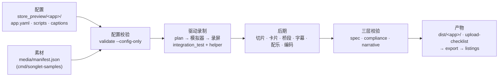

# App Store 预览视频 · 操作手册（store-preview）

适用：Songlet（`store_preview/songlet`）以及任何基于 iap_template 的应用。
同源的 Claude Code 技能：`.claude/skills/store-preview/SKILL.md`。
所有命令在**仓库根目录**执行，并且该检出须含 `packages/store_preview/` 与 `store_preview/songlet/`（`main` 分支）。
数值来自 2026-10-06 的实际运行（创意素材为 2026-10-10）。规则原文见 `docs/store/apple-preview-rules.md` 与 `docs/store/creative-assets-specs.md`，决策见 ADR-0038、ADR-0039 与模板 ADR-0001–0014。

---

## A. 一页速查

**前置条件（本次实测版本）**

| 项 | 版本 / 型号 |
| --- | --- |
| macOS / Xcode | 27.0.1 / Xcode 27.0（27A266a），Swift 6.4 |
| 模拟器 | iPhone 18 Pro Max · iOS 27.0（工具默认自建 `Store Preview (iPhone 17 Pro Max)`） |
| Flutter / Dart | 3.44.2 / 3.12.2 |
| ffmpeg | Homebrew `ffmpeg` 9.0.2（需含 `aac_at`、`libx264`）；平台 worker 另需 `ffmpeg-full`（libass） |
| Go（产品仓素材生成） | go1.27.0 |
| Node（ascpub 上传） | v26.8.1，ascpub 0.1.0 |

**三个入口命令**

```sh
dart run store_preview new-app <name>                                   # 新应用：生成配置骨架
make store-preview                                                      # 录制 A/B/W → 预览 → 创意素材 → assets-manifest.json
make store-preview ARGS="validate --app songlet"                        # 配置 + 三层校验（不录制）
```

`make store-preview` 不带 ARGS 时等同 `render --app songlet --scripts A,B,W --locales all`（W 只录画面、不出预览，供婚礼 CPP 使用）。每次 render 前先执行 `make l10n`：生成代码不入 git，render 也不会重新生成它。

**产物**：`dist/songlet/<storefront>/{A,B}.mp4`，以及同名的 `.poster.png`、`.captions.srt`、`.edl.json`，外加 `dist/songlet/upload-checklist.md`。原始录屏在 `build/store_preview/songlet/raw/<storefront>/iphone/`。

**耗时（2026-10-06 实测）**

| 范围 | 用时 |
| --- | --- |
| 驱动准备（`flutter build` + `xcodebuild build-for-testing`，首个 take 前一次） | ≈ 3.5 min |
| 每个 storefront 录 A+B | ≈ 3 min 05 s（其中录屏 141–150 s） |
| 每条合成 | ≈ 12 s |
| 全量 12 × 2 | 42 min（06:16:26 → 06:58:28） |
| studio_app 样片（1 条，无 helper） | ≈ 2 min |
| 单 storefront 只录 A（en-US，驱动已缓存） | 154 s（新会话按 SKILL 实测，14:59:35 → 15:02:09） |

---

## B. 环境与凭据

| 名称 | 用途 | 来源 / 权限 |
| --- | --- | --- |
| `config/mock.json` | 录制用 app 的 dart-define（mock 后端） | `cp config/mock.example.json config/mock.json`；git 忽略 |
| `STORE_PREVIEW_SIM_IPHONE` | 指定录制用模拟器 UDID（每个 take 会**抹掉**它） | 可选；不设则自建专用模拟器 |
| `SONGLET_SAMPLES_DIST_SECRET` | `songlet-samples` 对 BFF 签名用的分发密钥（分发 `e2e.songlet.ios`） | 平台仓 `go run ./cmd/signtool -derive-root <root hex64> e2e.songlet.ios` 派生；root 由平台维护者持有 |
| `PLATFORM_DSN` | `songlet-samples` 只读查询授权 ID（`interaction_id`、调用日志 ID） | 平台库连接串，平台维护者发放 |
| `AUTH_TOKEN_SECRET` / `PRODUCTS_JWT_SECRET` | 本地平台签发 JWT / 产品 BFF 校验 JWT，两者须相同 | 平台仓 `.env`（见 `.env.example`）；本地起 BFF 时导出为 `PRODUCTS_JWT_SECRET` |
| `ASC_KEY_ID` `ASC_ISSUER_ID` `ASC_KEY_PATH` | ascpub 上传 App Store Connect | 开发者账号管理员发放的 API Key（.p8） |

**绝不能进仓库或日志**：以上所有值、DSN 里的口令、`.p8` 文件、派生 root。`validate` 会扫描配置与产物里形似凭据的字符串。

**attest 档位**：分发的 `acfg_configs.config.attest.mode` 取值为 `off`（缺省）、`optional` 或 `required`。`songlet-samples` 用 `{unsupported:true}` 注册游客，只在 `off` 或 `optional` 档下可用。本次本地分发 `e2e.songlet.ios` 没有 `attest` 键（即 `off`）；`com.songlet.ios` 为 `required`。在其他环境开启或撤销，以库属主身份执行，写法同平台仓迁移 `docs/migrations/20260926f_songlet_attest_required.sql`：

```sql
-- 申请（改为 optional）
UPDATE public.acfg_configs SET config = jsonb_set(COALESCE(config,'{}'::jsonb), '{attest}', '{"mode":"optional"}', true),
       version = version + 1, updated_at = now() WHERE tenant_id = 0 AND distribution_code = '<分发>';
-- 撤销（回到缺省 off；生产分发应恢复 required）
UPDATE public.acfg_configs SET config = config - 'attest', version = version + 1, updated_at = now()
 WHERE tenant_id = 0 AND distribution_code = '<分发>' AND config ? 'attest';
```

**预充值额度**：实测单价为歌曲 49 积分、歌词视频 57 积分；图片走平台图像工具，不扣钱包（48 张平均 `cost_amount` 为 0.1010）。最低额度 = 49 × 歌曲数 + 57 × 视频数；本次 27 首 + 12 条 = **2007**。实际扣了 5041（重拍与修复后重渲，约 2.5 倍），建议按 2.5 × 最低额度充值。充值脚本是平台仓 `docs/ops/wallet-init-and-set-balance.sql`。

**DB 只读确认**：`psql "$PLATFORM_DSN" -Atc "select current_user; show transaction_read_only;"`，远端应返回只读账号且为 `on`。本次本地 Docker 库用的是属主账号；`songlet-samples` 只执行 SELECT。

---

## C. 素材生成（产品仓 `cmd/songlet-samples`）

前提：本地平台、worker 与产品 BFF 已启动（BFF 在 `:9910`），设备已充值。

```sh
# 平台仓 genaistudio
make run-server
PATH=/opt/homebrew/opt/ffmpeg-full/bin:$PATH make run-worker      # 歌词视频字幕需 libass
# 产品仓 genaistudio-products（PRODUCTS_JWT_SECRET = 平台 AUTH_TOKEN_SECRET）
set -a; . ./.env; set +a; export PRODUCTS_JWT_SECRET=…; go run ./cmd/product-api
# 生成 / 续跑（已有文件且已记录的条目不会再生成，也不会再付费）
go run ./cmd/songlet-samples -base http://localhost:9910/v1 -dist e2e.songlet.ios -device <已充值设备 UUID> \
  -store-preview <songlet 仓>/store_preview/songlet -platform-dsn "$PLATFORM_DSN" \
  -nb-command ../genaistudio/scripts/nb-image-gen.sh -parallel 4 -timeout 15m
```

预期最后一行：`✓ …/store_preview/songlet/media/manifest.json (84 entries)`。

**manifest（schema 2）**

```json
{"schema": 2, "entries": [{"id": "song.A.ja", "type": "audio", "role": "song", "locale": "ja", "script": "A",
  "file": "songs/ja_A.mp3", "license": {"provider": "lyria", "id": "v1_…", "model": "lyria-3.5", "generated_at": "2026-10-05T09:22:29Z"},
  "vars": {"recipient": "Alex", "keyword1": "珈琲", "chorus_index": "2", "lyric_language": "ja", "sung_name": "Alex"},
  "data": {"prompt": "…", "lyrics": "…", "structure": […], "job_id": "…"}}]}
```

| 角色 | 文件 | license | 每个 storefront 数量 |
| --- | --- | --- | --- |
| `song` | `songs/<id>_{A,B}.mp3` | lyria 的 interaction id | 2 |
| `lyric_video` | `videos/<id>_B.mp4` | 平台 MV 任务 id | 1 |
| `photo` | `images/<id>_B_{1..4}.png` | 平台图像调用 id | 4 |

**补生成单条**：删除该文件，用同一命令加 `-storefronts <id>` 重跑，新条目会替换旧条目。歌曲在缺段落时间或 A 的副歌没唱出名字时会自动重拍，最多 3 次。**schema 1 迁移**：同一命令加 `-migrate`（不生成，也不连 BFF）。

**授权 ID 校验失败的排查顺序**：
1. `make store-preview ARGS="validate --app songlet --config-only"`，看是哪一条：`license.id is empty`、`file not found`、`needs N … holds M` 或 `vars.X is missing`。
2. 歌曲 id 为空时，确认平台已含提交 dd4c080（音乐步骤写入 `interaction_id`），然后删除文件重生成。
3. 视频或图片 id 为空时，重生成该条。
4. 报 `script C is not an active script` 时，该条属于归档脚本，应移到 `archive/<script>/`。

---

## D. 脚本与字幕

**`store_preview/songlet/scripts/<id>.yaml` 字段**

| 字段 | 说明 |
| --- | --- |
| `template`、`rhythm` | 叙事模板，节拍为 15、22 或 25 秒；总时长必须等于节拍 |
| `poster_at` | 封面秒数，必须落在 `finished: true` 场景内；`publish.shared_poster_at` 也须满足 |
| `requires` | 所需素材：`role`、`count`、`script`、`vars` |
| `setup` | 镜头外步骤；`{do: use, role: song}` 选歌并展开为 app.yaml 的 `on_use` |
| `segments` | 时间线，三种片段：`card: intro\|outro`、`scene`（`beat`、`duration`、`steps`、`before`、`finished`、`follow`、`audio`、`max_speed`、`shoot_order`、`retime`）、`bridge`（`image`） |
| `captions` | `{key, from, to}`，不得与卡片重叠 |

**模板选用**

| 模板 | 适用 |
| --- | --- |
| `input_wait_result_share` | 生成类应用（Songlet 的 A、B） |
| `hook_problem_result_cta` | 工具类，前后对比 |
| `feature_triptych` | 功能面广（studio_app） |

每个节拍允许 ±2 s 弹性；开场卡必须写主张，0–3 s 必须一直有文字。

**ARB 流程**：键前缀 `storePreview`，13 个 ARB 位于 `lib/l10n/arb/app_<locale>.arb`。

```sh
make l10n
make store-preview ARGS="captions --app songlet"     # 预期：✓ captions: 12 storefronts → store_preview/songlet/captions
```

**长度与读速**：字幕和主张 ≤ 28 字符（中日韩 ≤ 14）；披露 ≤ 60（中日韩 ≤ 30）；每条 ≥ 1.5 s，读速 ≤ 17 字/秒（中日韩 ≤ 9）。不得出现价格、各语言的 "free"、日期季节词，以及 `banned_words` 中的竞品名。

**缺键补齐**：报错 `ja: storePreviewX is missing (add it to app_ja.arb)` 时，把该键加到对应 ARB；英文源在 `app_en.arb`，同时写 `@键` 描述。

---

## E.1 渲染参数与三层校验

```sh
make l10n                                                                           # 先确保生成代码最新
make store-preview ARGS="render --app songlet --scripts A --locales en-US"         # 单条排练
make store-preview ARGS="render --app songlet --scripts A,B --locales ja,ko"        # 指定语言
make store-preview ARGS="compose --app songlet"                                     # 用已录素材重合成
STORE_PREVIEW_SIM_IPHONE=<udid> make store-preview ARGS="render --app songlet"      # 指定模拟器
```

| 参数 | 取值 |
| --- | --- |
| `--scripts` | `A`、`B` |
| `--locales` | `all`，或 storefront id：`en-US ja de-DE fr-FR pt-BR es-MX hi ko id vi tr zh-Hans`（`en` 会被拒：`en is not a storefront of songlet`） |
| `--devices` | `iphone`（`ipad` 在 `TARGETED_DEVICE_FAMILY` 不含 2 时会被拒绝） |

预期结尾。render 与 validate 会重新生成入库的 `docs/store/preview-upload-checklist.md`，内容始终覆盖全部脚本；`export` 也总是导出全部脚本：

```
en-US  A  iphone  886×1920  25.01s  30.00  h264 High@4.0 11.01M  aac 2ch 44100 256k  33.6MB  86.0%  13.0s player  pass  pass  pass  PASS
✓ 1 previews pass the spec, compliance and narrative layers
```

| 层 | 典型失败信息 | 修复 |
| --- | --- | --- |
| spec | `video bitrate … outside 10–12 Mbps`、`resolution ≠ 886×1920`、`audio bitrate ≠ 256 kbps` | 用 Homebrew ffmpeg（含 `aac_at`）重新 compose；不要改编码参数 |
| compliance | `app footage is 84.7 % (≥ 85 %)`、`card intro lasts 2.4s`、`does not disclose the purchase`、`looks like a price` | 缩短卡片或桥段；补 `disclosure_key` 的文案；改字幕 |
| narrative | `on-screen text covers only 0–0.80s`、`poster_at … not inside a finished scene`、`reads at 20.0 characters/s` | 字幕从开场卡结束处接上；调整 `poster_at`；缩短文案 |

## E.2 本次遇到的报错

| 报错 | 原因 | 定位 / 修复 |
| --- | --- | --- |
| `something already serves http://localhost:8787/__admin/state` | 上次的 mock 未退出 | `lsof -iTCP:8787 -sTCP:LISTEN`，kill 该进程 |
| `… was filmed for X s, its slot is Y s (allowed ×1–×N) — adjust the script's pauses` | 场景步骤太快或太慢 | 调整该场景的 `pause` |
| `the recording run failed: … timed out … waiting for …` | finder 没找到元素 | 看 `build/…/raw/<id>/iphone/test.log` 末尾的 `on screen:` 文本 |
| 开场卡溶入半关的 sheet | 场景开始时 sheet 仍在动画 | setup 末尾加 `waitGone` 与 `pause` |
| 作品页闪现“不在此设备上” | 任务完成早于音频落盘（App 已修，f70b790） | `before_take` 中 `demo_delay_ms: 9000` |
| 印地语键盘引导遮挡 | 系统多语言键盘提示 | `simulator.keyboard_tips_seen: true`（默认开） |
| `QUOTA_EXHAUSTED`（49303） | 测试钱包没额度 | 按 B 节充值后续跑 |
| BFF 40102 | BFF 与平台的 JWT 密钥不一致 | `PRODUCTS_JWT_SECRET` 设为平台的 `AUTH_TOKEN_SECRET` |
| `MV_RENDER_FAILED`（缺 subtitles 滤镜） | worker 的 ffmpeg 无 libass | worker 的 `PATH` 前置 `ffmpeg-full` |
| 装 ffmpeg-full 后 ffmpeg 与 libheif 报库错 | x265 升级 | `brew upgrade ffmpeg libheif` |
| 歌词视频字幕成墙、词粘连 | 平台拼词与切条逻辑（已修，7a84cd7） | 平台含该提交后，删除视频文件重渲 |
| 照片里有文字或人物 | 生成图不合规 | 收紧 `photo_style` 或该国 `photo_briefs`，删文件重生成 |
| `… is schema 1: run … -migrate first` | 旧 manifest | 生成命令加 `-migrate` |
| `no listings/…/previews/iphone-6.9` | 导出目录配置错 | 改 `publish.device_dirs` |
| `unknown key(s) …` | YAML 字段拼写错 | 按报错中 `allowed:` 列表修正 |
| `xcodebuild build-for-testing failed (see …/xcode.log)`，日志里 `getter … isn't defined for … AppLocalizations` | `lib/l10n/generated` 过期（render 不重新生成） | `make l10n` |
| `app.yaml bundle_id is tool.genai.generator, the built app is com.songlet.ios` | 发布身份改了（05762f6） | 改 `app.yaml` 的 `bundle_id` |
| `timed out … {"key":"composer.create","widget":"IconButton"}`、`… {"key":"player.sections"}` | UI 改版（三态 composer；选卡默认 30 s 预览，ADR-0036） | `git grep -ho "'composer\.[a-zA-Z.]*'" lib/ui \| sort -u` 查当前 key；A 在镜头外把长度设为 Standard |
| `does not ship for the ipad slot` | App 只支持 iPhone | 不录 ipad（ADR-0037） |
| 模拟器被抹掉 | 用了个人模拟器 | 只用专用模拟器或明确授权的 UDID；不要 `simctl shutdown all` |

---

## F. 上传

1. 导出到 listings：`make store-preview ARGS="export --app songlet"`。预期每个语言一行 `✓ listings/com.songlet.ios/locales/<id>/previews/iphone-6.9: A.mp4, B.mp4`。`listings/` 在主检出、不入 git；工作树里可临时 `ln -s ../songlet/listings listings`，用完删除。
2. 每个本地化在 iPhone 6.9" 槽按 **A → B** 的顺序上传，A 自动播放。
3. 封面统一设在 `00:00:13:00`，两条都是成品画面。ascpub 通过 `listings/com.songlet.ios/base.yaml` 的 `preview_frame_time_code` 设置；手动上传时，在每条预览的封面设置里拖到 13 秒再保存。
4. ASO 名称与副标题以 `store_preview/songlet/app.yaml` 的 `storefronts[].aso_name` 和 `aso_subtitle` 为准；`dist/songlet/upload-checklist.md` 的「Per storefront」表逐语言引用。
5. 上传命令：`ascpub validate` → `ascpub ship --dry-run` → `ascpub ship`。

**提交审核前核对**
- [ ] `validate --app songlet`：24 条全部 PASS
- [ ] 静音观看任意 3 条：0–3 秒能看懂卖点
- [ ] 收尾卡披露在每种语言都存在
- [ ] 提审版本包含预览展示的全部功能（WAV 导出未展示）
- [ ] 每个语言恰好 A、B 两条，没有残留的 `C.mp4`
- [ ] 名称和副标题与清单一致

---

## G. 新应用接入（以 studio_app 为例）

在模板仓根目录（`iap_template`）执行。总计约半天，其中写场景步骤占 1–3 小时。

```sh
dart run store_preview new-app studio_app
```

预期输出：

```
✓ store_preview/studio_app for Iap Template (org.vizgo.ai), storefronts en, zh
  + store_preview/studio_app/app.yaml
  + store_preview/studio_app/scripts/A.yaml
  …
  + integration_test/store_preview_test.dart
```

1. 在 `pubspec.yaml` 的 dev_dependencies 中加 `integration_test: {sdk: flutter}` 和 `store_preview_driver: {path: packages/store_preview_driver}`，然后 `flutter pub get`。
2. 骨架原样可通过校验：`dart run store_preview validate --app studio_app --config-only`，预期 `✓ configuration: 1 script(s), 2 storefront(s), …`。
3. 填写 `app.yaml`：
   - `brand.name: "Studio"`
   - `palette: {primary: "#7C5CFF", on_primary: "#FFFFFF", scrim: "#141A30"}`
   - `driver.ready: {widget: NavigationBar}`
   - `rules.require_image_transition: true`
   - 每个 storefront 的 `aso_name`、`aso_subtitle` 和 `vars: {tab_profile: …, tab_upload: …}`
4. 写场景：`scripts/A.yaml` 用 `feature_triptych@15`；步骤如 `{do: tap, label: "{tab_upload}"}`；不拍会显示价格的付费墙。
5. 素材：`media/manifest.json` 放一张带授权 id 的图片，用作开场卡背景。
6. 驱动入口：`integration_test/store_preview_test.dart` 用 demo 数据启动 App（覆盖 startup、account、wallet、appConfig 等 provider，不需要后端）。
7. 出样片：`dart run store_preview render --app studio_app --scripts A --locales en-US`。预期一行 PASS：`15.00s … 85.3% 3.0s profile … PASS`，耗时约 2 分钟。

---

## H. 变更指南

| 要改什么 | 动哪些文件 | 然后 |
| --- | --- | --- |
| 字幕文案 | `lib/l10n/arb/app_*.arb`（13 个）中的 `storePreview*` 键 | `captions` → `compose` |
| 字幕时间 | `scripts/<id>.yaml` 的 `captions` | `compose` |
| 配乐 | 场景的 `audio: {role: …}`；新增 manifest 条目（role 自定，旁白用 `voiceover`，会自动压低音乐） | `render` |
| 加一个 storefront | `app.yaml` 的 `storefronts`；对应 ARB；`generation.yaml` 的 `keywords` 与 `photo_briefs`；生成素材 | `render --locales <id>` |
| 加一条脚本 | 新建 `scripts/<id>.yaml`；`requires` 所需素材；新的 caption 键；`publish.upload_order` | `validate --config-only` → `render --scripts <id>` |
| 品牌卡 | `app.yaml` 的 `brand`（icon、palette、font、cta_key、disclosure_key）；卡片的 `duration` 与 `background` | `compose` |
| 创意素材 | `creatives/*.yaml`（画面帧、视频场景、id）；`storeCreative*` ARB 键；CPP 页面与深链在 ascpub 的 `listings/com.songlet.ios/cpp/` | `creatives` → 复核 → `manifest`（见 J 节） |
| 工具本身 | **只在模板仓改**，然后在模板仓执行 `dart run store_preview vendor --from . --root <songlet 仓>` | 在 Songlet 执行 `dart run store_preview vendor --check` |

**Apple 规则更新时的复核方法**：
1. 重新抓取 `docs/store/apple-preview-rules.md` 顶部列出的三个页面，逐段对照原文引文。
2. 规格数值有变时，改模板仓 `packages/store_preview/defaults/encoding.yaml` 与 `devices.yaml`，以及 `lib/src/validate/spec.dart` 中的常量。
3. 改我方阈值时，改 `Rules.defaults`（`lib/src/config/app.dart`），并在 rules.md 的「How the tool applies them」表中注明来源。
4. 最后在模板仓执行 `make test`，再重新 vendor 到 Songlet。

---

## I. 架构速览



| 模块 | 路径（模板仓源码，Songlet 中为 vendored 副本） |
| --- | --- |
| 配置与 manifest | `packages/store_preview/lib/src/config/` |
| 叙事模板 | `packages/store_preview/templates/`、`lib/src/narrative/` |
| 录制计划 | `lib/src/plan/` |
| 模拟器与录屏 | `lib/src/device/` |
| 驱动与后端 | `lib/src/driver/`、`packages/store_preview_driver/`、`native/ios/StorePreviewHelper.swift` |
| 后期 | `lib/src/post/`、`native/cut_scenes.swift`、`native/render_text.swift` |
| 校验 | `lib/src/validate/` |
| CLI、发布与骨架 | `lib/src/cli/`、`lib/src/publish/`、`lib/src/scaffold/` |
| Songlet 配置与驱动入口 | `store_preview/songlet/`、`integration_test/store_preview_test.dart`、`ios/RunnerUITests/StorePreviewHelper.swift` |

---

## J. 创意素材（产品页 Header / 搜索结果 / 自定义产品页）

Apple 2026-10-05 推出、iOS 27 起展示。store-preview 只负责生产和校验，不调用 App Store Connect，也不持有任何凭据；上传由 ascpub 完成。

**一条命令**：`make store-preview`。录制完成后依次输出 `▶ creative assets → dist/songlet/creative`、`▶ validate the creative assets`（每行三层 PASS）、`✓ dist/songlet/assets-manifest.json …`。只重出素材、不重录时：`make store-preview ARGS="creatives --app songlet"`。

**产物（每个 storefront）**

| id | 规格 | 文件 |
| --- | --- | --- |
| `header.<sf>` | Header 图 3840×1646 PNG | `dist/songlet/creative/<sf>/header.<sf>.png` |
| `header.<sf>.video` | Header 视频 3840×1646，12 s，30 fps，无音轨 | `….mp4` + `.poster.png` |
| `search.<sf>` | Search 图 3840×2560 PNG | |
| `search.<sf>.video` | Search 视频 2880×1920，15 s，30 fps，无音轨 | |
| `cpp.<slug>.header[.<sf>]`、`cpp.<slug>.search[.<sf>]` | 生日 / 照片成歌 / 婚礼三个 CPP 的 Header 与 Search 图；不带 `<sf>` 的是通用图（无文字） | `creative/universal/`、`creative/<sf>/` |
| `header.universal.tool` | 通用 16:9 5244×2950 PNG（Header 与 Search 共用） | `creative/universal/` |

合计 127 条，另有 `dist/songlet/assets-manifest.json`，以及每条素材的 `.edl.json`（所有来源的哈希与参数、所有授权 id）。

**契约与页面归 ascpub 所有**
- `app.yaml` 的 `creatives.ascpub` 指向 ascpub 检出目录（`../../Tools/ASOShip`，可用环境变量 `ASCPUB_ROOT` 覆盖），并固定 `assets-manifest.schema.json` 的 SHA-256。ascpub 一旦改动契约，工具会停下并报出新旧哈希；读完改动后再更新 `schema_sha256`。工具内不保留 schema 副本。
- `creatives.ascpub.listing` 指向 ascpub 的 listing（`../songlet/listings/com.songlet.ios`，即主检出、未入 git）：`assets.yaml` 与 `cpp/{birthday,photo,wedding}.yaml`（深链也在这里，store-preview 不读不写）。target 找不到对应页面，或页面绑定的 id 没有被生产，都会报错。
- 查看契约状态：`make store-preview ARGS="contract --app songlet"`。
- **上架绑定（货架）**：模板 ADR-0015 起，素材定义可以用 `shelf:` 声明每个页面在 Header / Search 上展示哪一件，再由 `make store-preview ARGS="listing --app songlet --write"` 写进 listing。**Songlet 的 `shelf:` 声明商店实际展示的内容**（2026-10-11 起）：默认页与三个 CPP 只上架通用图，即已上传资产库的 7 件（`header.universal.tool`、`cpp.{birthday,photo,wedding}.{header,search}`）；listing 与之不符时配置校验报错，`listing --app songlet --write` 写回。把本地化素材加进 `shelf:`（例如让 12 个 storefront 上架各自的版本）会改变商店展示内容，属于产品决策，需在上传、送审后才生效。完整业务流程见模板 `docs/store/asset-library-playbook.zh-CN.md`。

**人工复核（real_ui）**
1. 查看 `dist/songlet/creative/sheets/`：`<asset>.png` 是全部 storefront 的拼图（视频取海报帧）；`<asset>.first2s.png` 是视频前 2 秒（0 / 0.5 / 1 / 1.5 / 2 s，每行一个 storefront），用来静音判断能否看懂。
2. 对每个素材定义记录结论：`make store-preview ARGS="review --app songlet --asset header.{storefront}.video --real-ui true --reviewer <姓名>"`。不带 `--asset` 时列出全部素材的复核状态。
3. 重新写清单：`make store-preview ARGS="manifest --app songlet"`。
未复核或复核已过期（素材内容变了）的条目，`real_ui` 一律为 `false`。

**本地验收（一条命令，离线）**：`make asset-library`（`scripts/asset_library_check.sh songlet`）依次执行 `listing`、`validate --app songlet --only creatives`（127 条素材三层校验 + 清单复测），再对 `../songlet/listings/com.songlet.ios` 执行 ascpub 的 `assets` / `cpp` / `ppo validate`。全部通过即可交给 ascpub。需要已构建的全局 `ascpub`（在 ASOShip 执行 `npm run build && npm link`），或设置 `ASCPUB`。

**交给 ascpub**（在 Songlet 主检出 `songlet/` 执行）
```sh
ascpub assets validate -b com.songlet.ios      # 离线：清单 + 文件规格 + 绑定；预期 0 个错误
ascpub assets push --dry-run -b com.songlet.ios # 联网只读，需要 ASC_* 凭据，由人执行
```
2026-10-10 已上传 listing 绑定的 7 条（`header.universal.tool` 与六条 `cpp.<slug>.header|search`），状态 `PREPARE_FOR_SUBMISSION`；独立送审要等 1.0 获批。

**常见失败 → 修复**
| 信息 | 修复 |
| --- | --- |
| `ascpub's assets-manifest.schema.json is …, the app follows …` | ascpub 改了契约：阅读改动，再更新 `creatives.ascpub.schema_sha256`（版本号变化时需同时修改模板仓的工具） |
| `no ascpub contract at …` | 设置 `ASCPUB_ROOT`，或修正 `creatives.ascpub.root` |
| `target custom_product_page:x: ascpub's listing … declares no such page` | 在 ascpub 侧建页面（`ascpub assets init --cpp x`），或改正 target |
| `… binds <id>, which no creative definition makes` | 在 `creatives/*.yaml` 中生产该 id，或在 ascpub 页面配置里改绑定 |
| `the backdrop is not a licensed manifest item` | 背景必须是 `media/manifest.json` 中带授权 id 的条目 |
| `the first scene lasts …; muted, the opening holds one scene for 2s` | 第一个场景至少 2 s |
| `… is outside the spec's 10.0–30.0 s` / `15.0–30.0 s` | Header ≥ 10 s、Search ≥ 15 s（ADR-0013），换用 12 / 15 s 节奏 |
| `contrast …` | 换一张背景，或在 `app.yaml creatives.layouts.<比例>.backdrop.brightness` 中调得更暗（只能更严） |
| `… was filmed for X s … does not fit` | 调整 `creatives/*.yaml` 中的 `from` / `duration`，或延长对应场景的 pause |

**耗时（2026-10-10 实测，`make store-preview` 一条命令，09:09:47 → 10:11:04，共 61 min）**

| 阶段 | 用时 |
| --- | --- |
| 驱动准备 + 12 个 storefront 录 A/B/W | ≈ 40 min（每个 storefront ≈ 3.4 min，W 约多 6 s 画面） |
| 24 条预览合成 + 校验 | ≈ 5 min |
| 127 条创意素材渲染 + 复核拼图 | ≈ 14.5 min（视频每条约 40 s，图片每张约 4 s） |
| 创意素材三层校验 + 写清单并复测 | ≈ 1 min |
| 只重出 en-US 的 17 条素材（`creatives --locales en-US`） | 95 s |
| `ascpub assets validate`（含视频完整解码） | 0 个错误，1 条快照警告 |
